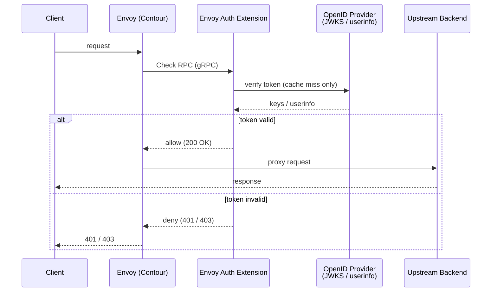

# Envoy Auth Extension

A gRPC service that implements the [Envoy external authorization API](https://www.envoyproxy.io/docs/envoy/latest/api-v3/service/auth/v3/external_auth.proto) (`envoy.service.auth.v3.Authorization/Check`). It is deployed as a [Contour](https://projectcontour.io/) `ExtensionService`, allowing Envoy to delegate per-request authentication to this service before proxying traffic to upstream backends.

For every incoming request, Envoy calls this service's `Check` RPC. The service inspects the `Authorization: Bearer <token>` header, verifies the token against a configured OpenID provider, and returns an allow (`200 OK`) or deny (`401 Unauthorized` / `403 Forbidden`) response.

## How It Works



1. Envoy receives a request and issues a `Check` RPC to this service.
2. The service extracts the bearer token from the `authorization` header.
3. The token is verified using the configured strategy (`jwt`, `opaque`, or `jwtuserinfo`), then its claims are checked against the optional required-claim rules (see [Required Claims](#required-claims)). Verified results are cached in an in-memory `AuthCache` with a configurable TTL and size; JWKS keys are cached with their own TTL.
4. On success, the service returns `OK` and Envoy proxies the request upstream.
   On failure, it returns `401` (unauthenticated) or `403` (forbidden).

The service also exposes standard gRPC [health checking](https://grpc.io/docs/guides/health-checking/) (`grpc.health.v1.Health`) and [server reflection](https://grpc.io/docs/guides/reflection/) (`grpc.reflection.v1.ServerReflection`).

## Project Layout

| Path | Description |
| --- | --- |
| `crates/envoy-auth-ext/` | The service crate (binary + library). |
| `crates/envoy-auth-ext/src/main.rs` | Entry point: CLI parsing, OTEL setup, runtime bootstrap. |
| `crates/envoy-auth-ext/src/lib.rs` | `AuthServer` construction and gRPC server wiring. |
| `crates/envoy-auth-ext/src/handlers/grpc.rs` | The `Authorization/Check` implementation. |
| `crates/envoy-auth-ext/src/settings/` | Configuration structs and file parsing. |
| `helm/` | Helm chart for Kubernetes/Contour deployment. |
| `docker/` | Dockerfile and local `docker compose` stack (Envoy + OTEL gateway). |
| `proto/vendor/` | Vendored Envoy and Google protobuf definitions compiled by `build.rs`. |

## Prerequisites

- [Rust](https://www.rust-lang.org/) 1.97 (pinned via `rust-toolchain.toml`;
  `rustup` installs it on first use).
- The protobuf compiler, [`protoc`](https://protobuf.dev/installation/), used by
  `build.rs`.
- [`cargo-nextest`](https://nexte.st/) (optional) as the test runner.
- [Docker](https://www.docker.com/) for local compose and image builds.
- [Helm](https://helm.sh/) and `kubectl` for deployment.
- [`grpcurl`](https://github.com/fullstorydev/grpcurl) (optional) to call the
  `Check` RPC by hand.

## Build

```shell
cargo build
```

Protobuf definitions are compiled at build time via `build.rs` from the vendored copies in `proto/vendor/`, so the build needs no access to a schema registry.

## Test

```shell
cargo nextest run --workspace   # or: cargo test --workspace
```

## Lint

```shell
cargo fmt --all -- --check
cargo clippy --workspace --all-targets
helm lint helm/
```

## Configuration

The service is configured with a TOML or JSON file passed via `--config`.
Layering is: built-in defaults first, then values from the supplied file.

```shell
# Run with a config file
envoy-auth-ext --config docker/envoy-ext-config.toml

# Generate a config file pre-populated with the current defaults
envoy-auth-ext --generate config.toml
```

Example configuration (`docker/envoy-ext-config.toml`):

```toml
[server]
ip_address = "0.0.0.0"
port = 50051
username_claims = ["preferred_username"]  # JWT claims tried in order; first present wins

[server.tonic]
initial_connection_window_size = 65535
initial_stream_window_size = 65535
max_decoding_message_size = 4194304

[auth]
authentication_type = "jwt"   # jwt | opaque | jwtuserinfo
jwt_audience = []             # required for jwt and jwtuserinfo; startup fails if omitted; tokens without a listed `aud` are rejected
jwt_issuers = []              # accepted `iss` values; when set, tokens without a listed `iss` are rejected
jwt_required_claims = []      # e.g. [{ claim = "appid", operator = "in", values = ["web-client"] }]; see Required Claims
principal_id_claim = "sub"    # verified claim used as the principal id
jwt_leeway = 60               # clock skew in seconds tolerated for `exp` / `nbf`; keep within 0-300
token_cache_size = 2048
openid_configuration = "https://login.microsoftonline.com/<tenant>/v2.0/.well-known/openid-configuration"

[auth.jwks_ttl]
secs = 3600

[auth.token_ttl]
secs = 3600

# Outbound identity provider requests (discovery, JWKS, userinfo)
[idp_client.connect_timeout]
secs = 5

[idp_client.request_timeout]  # whole request, from connecting until the response body is read
secs = 15

[idp_client.pool_idle_timeout]
secs = 90
```

When deployed via Helm, these values are rendered into a `ConfigMap` from the `openId` and `config` sections of `values.yaml`.

### Rate Limiting

The service does not rate-limit checks itself. To bound the number of checks per Envoy pod, configure a
[local rate limit policy](https://projectcontour.io/docs/1.33/config/rate-limiting/#local-rate-limiting) on the
`HTTPProxy` virtual host or routes. Contour places Envoy's local rate limit filter before the external authorization
filter, so rate-limited requests never reach this service. Contour's global rate limit filter runs after external
authorization and does not reduce the number of checks.

### Required Claims

`jwt_required_claims` (Helm: `openId.requiredJwtClaims`) is a list of rules that the claims of every verified token must satisfy, in addition to the `aud` and `iss` checks. It is provided by the `permission-auth` crate and is empty by default, so no extra checks run.

Each rule names a top-level `claim`, an `operator`, and a string, integer, or boolean operand:

| Operator | Operand | Passes when the claim |
| --- | --- | --- |
| `equals` / `notEquals` | `value` | equals / is a scalar not equal to `value` |
| `in` / `notIn` | non-empty `values` | equals one of / is a scalar equal to none of `values` |
| `contains` | `value` | is an array containing `value` (a scalar claim is treated as a one-element array) |
| `containsAny` / `containsAll` | non-empty `values` | contains at least one / all of `values` |
| `exists` | none | is present |

- Every rule must pass. A missing or `null` claim fails every rule.
- Matching is exact and type-strict: `"3"` does not match `3`, and string comparison is case-sensitive.
- In `jwt` and `jwtuserinfo` modes the rules are evaluated against the verified JWT payload. In `opaque` mode they are evaluated against the userinfo response.
- A token that fails a rule is rejected with `401` and stored in the negative token cache.
- Invalid rules (unknown operator, wrong or missing operand, unknown field) fail startup.

Helm example:

```yaml
openId:
  requiredJwtClaims:
    - claim: "appid"
      operator: "in"
      values: ["web-client", "cli-client"]
    - claim: "groups"
      operator: "contains"
      value: "admins"
```

## Run Locally

A `docker compose` stack runs Envoy, this service, and an OTEL gateway together:

```shell
docker compose -f docker/docker-compose-envoy.yaml up
docker compose -f docker/docker-compose-envoy.yaml down
```

You can exercise the `Check` RPC against a running instance (listening on
`localhost:50051`) with a bearer token in `CURRENT_TOKEN`:

```shell
CURRENT_TOKEN=<token> tools/check-grpc.sh
```

## Deploy

Build the container image from the repository root:

```shell
docker build -t envoy-auth-ext:latest -f docker/envoy-auth-ext.Dockerfile .
```

Push it to a registry your cluster can pull from, and set `image.repository` and
`image.tag` (plus `imagePullSecrets` for a private registry) in your values file.
Then install the Helm chart in `helm/`:

```shell
kubectl create namespace envoy-auth-extension
# Install Contour and its CRDs if the cluster does not have them yet
kubectl apply -f https://projectcontour.io/quickstart/contour.yaml

helm install envoy-auth-extension helm/ --namespace envoy-auth-extension \
  --values my-values.yaml --dry-run   # render without applying
helm install envoy-auth-extension helm/ --namespace envoy-auth-extension \
  --values my-values.yaml
helm upgrade envoy-auth-extension helm/ --namespace envoy-auth-extension \
  --values my-values.yaml
helm uninstall envoy-auth-extension --namespace envoy-auth-extension
```

The chart creates a `Deployment`, `Service`, `ConfigMap`, and a Contour `ExtensionService` so Envoy can discover and route auth checks to this service.

## Observability

The service is instrumented with [OpenTelemetry](https://opentelemetry.io/) for both traces and metrics, exported via OTLP. The Helm chart configures each signal independently through `observability.tracing` and `observability.metrics`; direct deployments can use the standard `OTEL_*` environment variables. Set `OTEL_SDK_DISABLED=true` to turn all telemetry off. Notable metrics include `rpc.server.duration` (per-RPC latency) and process `up` / `uptime` gauges.

## Production Deployment Settings

_Draft: These are initial values for production deployment_

Recommended starting values for `helm/values.yaml`. This service sits in the hot path of every proxied request, so favor scaling out early over saturating a single replica. Profile with `kubectl top pods` and tune from there.

```yaml
resources:
  requests:
    cpu: 50m
    memory: 64Mi
  limits:
    cpu: 500m
    memory: 128Mi

autoscaling:
  enabled: true
  minReplicas: 2
  maxReplicas: 10
  targetCPUUtilizationPercentage: 60
  # targetMemoryUtilizationPercentage: 80
```

- **CPU** — Requests stay low since a compiled Rust binary handles JWT validation and cache lookups cheaply; the higher limit provides burst headroom so auth latency stays flat during traffic spikes.
- **Memory** — The token cache is bounded (`tokenCacheSize`), so the footprint is small and predictable; the limit is set to double the request for safety.
- **Replicas** — Run at least 2 so a pod restart or node drain never takes down all auth. Scale on CPU at 60% of request to add capacity before hitting the limit; leave memory-based scaling off unless needed, as it can cause thrashing.
