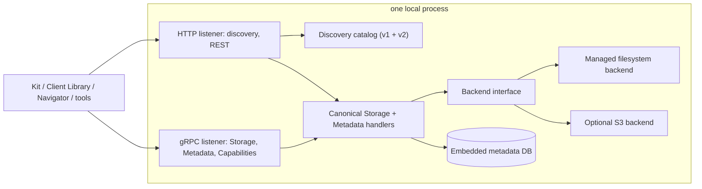

# Build a single local host for Discovery, Storage, and Metadata

> **Applies to:** a new local executable built from this repository's contracts and libraries · **Released:** not a released component · **This repo's snapshot:** unreleased Storage API source (after 1.0.0-beta.4), Metadata API 0.3.0, Discovery protos (untagged), Storage Core with unreleased trait changes (source commit in [`SOURCE_VERSIONS.md`](../../../../../SOURCE_VERSIONS.md)) · **Sources:** [`storage/api`](../../../../../storage/api/), [`metadata/api`](../../../../../metadata/api/), [`discovery/api`](../../../../../discovery/api/); Storage Core [`docs/applications.md`](../../../../../storage/reference/storage-core/docs/applications.md), [`docs/backends.md`](../../../../../storage/reference/storage-core/docs/backends.md); Storage Service [`src/api/discovery/`](../../../../../storage/reference/storage-service/storage-service/src/api/discovery/) and [`src/api/metadata_api/`](../../../../../storage/reference/storage-service/storage-service/src/api/metadata_api/); operator [`docs/v1-response-schema.md`](../../../../../discovery/reference/discovery-service/operator/docs/v1-response-schema.md)

Back to [local process deployment](../local-process.md). This page is the recipe for building one executable that serves Discovery, Storage, and Metadata on a workstation, using local disk for content and an embedded database for metadata. Nothing like it ships in this repository yet; build it as a new component and keep it out of the snapshot directories ([`CONTRIBUTING.md`](../../../../../CONTRIBUTING.md)).

## Architecture

Keep three layers separate: **canonical API handlers** generated from the contracts, a **backend interface**, and **backend adapters**. Any UI is a separate, replaceable client of the public APIs; clients must work through Discovery and the APIs without it.

## Recommended foundation in this repo

| Need | Use | Notes |
| --- | --- | --- |
| gRPC and REST serving of the Storage API | [Storage Core](../../../../../storage/reference/storage-core/) `StorageService` builder ([applications guide](../../../../../storage/reference/storage-core/docs/applications.md)) | Serves both protocols from one implementation; tracks registered services and answers Storage `Capabilities.ListServices` automatically |
| Storage traits | `storage-core-builder` traits: `fileobject`, `filefolder`, `versioning`, `capabilities`, `metadata` | Implement only what you support; unimplemented methods return `UNIMPLEMENTED` ([backends guide](../../../../../storage/reference/storage-core/docs/backends.md)). Each method takes the whole `Request<_>`; this snapshot replaced `is_versioning_enabled` with v1alpha `is_versioned` and makes `write` deliver exactly `data_object_size` bytes ([storage-core-rust.md](../../develop/custom-storage-adapter/storage-core-rust.md)) |
| Local filesystem backend | New backend following the backends guide | Storage Core ships Azure and S3 backends, not a filesystem one |
| S3 backend (optional) | Storage Core `s3` feature | Treat anonymous (public) buckets as read-only |
| Top-level Metadata API (`metadata.v1beta`) | Protos in [`metadata/api`](../../../../../metadata/api/); model on Storage Service `src/api/metadata_api/` | Storage Core's metadata trait covers `storage.metadata.v1alpha` |
| Discovery capabilities (`discovery.capabilities.v2beta`, or the deprecated `v2alpha` the snapshot operator falls back to) | v2alpha protos in [`discovery/api`](../../../../../discovery/api/), v2beta in the operator's [`discovery-protos/`](../../../../../discovery/reference/discovery-service/operator/discovery-protos/README.md); model on Storage Service `src/api/discovery/` | Lets the operator in static mode, or the host's own catalog, report what is served |
| Discovery catalog | Implement `GET /api/v2/services` and `/api/v1/services` in the host | Follow the [Catalog API](../../../../../discovery/reference/discovery-service/operator/docs/api/docs/discovery-catalog-api.md) and [v1 schema](../../../../../discovery/reference/discovery-service/operator/docs/v1-response-schema.md) |
| Address normalization | [`common/url-normalizer`](../../../../../common/url-normalizer/) | Match the Storage Service's address handling |
| Telemetry | [`common/observability`](../../../../../common/observability/) | Optional locally |

Another language works too: generate bindings from the same `.proto` files and follow the same rules. The [Python filesystem example](../../../../../storage/api/filesystem_example/) shows a complete Storage API surface in Python.

## Build in stages that each work

1. **Contracts and Discovery.** Generate bindings from `storage/api`, `metadata/api`, and `discovery/api` at a recorded commit. Serve the v1 and v2 catalogs and the Discovery capabilities service. Validate the catalog shapes before adding storage.
2. **Managed filesystem storage.** FileObject, FileFolder, Versioning, and Capabilities in `v1alpha` and `v1beta`, over gRPC and REST.
3. **Metadata.** Both metadata services sharing one embedded database.
4. **Optional S3 connections.**
5. **Optional UI**, as a client of the public APIs.

## Contract rules

- Serve both Storage generations (`v1alpha`, `v1beta`) where the protos define them, over both REST and native gRPC. Copy, Move, CreateFolder, and ListRoutes are `v1alpha` only. Inspect the protos for native metadata, support queries, redirect, and multipart lifecycle methods; do not invent methods.
- Structured metadata: `nvidia.omniverse.storage.metadata.v1alpha.MetadataService` and `nvidia.omniverse.metadata.v1beta.MetadataService`, one database behind both. REST bodies follow the OpenAPI documents in `storage/api/openapi` and `metadata/api/openapi`, which are not always the same as protobuf JSON.
- Discovery generations are separate from Storage API versions. v1 returns `schema-version: 1` with flat entries (`id`, `name`, `type`, optional `rest` and `grpc` strings); v2 returns `schema-version: 2` with nested protocol blocks. Never return a v2 body on a v1 path. Advertise only services that are running, with the versions and names they actually serve.
- In an unauthenticated local mode, no identity provider is configured: do not advertise one, and Discovery must not require sign-in.

## Managed filesystem rules

A mount is a directory the host manages, not a folder users edit directly. Logical paths never map to arbitrary physical paths.

- **Content-addressed storage:** store content by whole-file SHA-256 with an atomically replaced manifest of names, versions, and content references. Deduplicate identical bytes across every file and version in one mount. Matching bytes never merge metadata.
- **Writes and concurrency:** stage and hash, serialize commits with an OS-level lock, then publish the manifest atomically. Every completed unconditional write creates a new version, even with identical bytes; the last committed write has the highest version. Conditional writes carrying a stale previous identity fail.
- **Versions:** numbered per file. Readers pin immutable identities.
- **Deletes:** deleting one historical version keeps the others. Deleting the current version hides the file and does not promote an older one; explicit reads of retained history still work. Deleting the base path removes all versions. Reclaim content only when nothing references it.
- **Copies and moves:** same-mount moves commit atomically. Cross-mount copies and moves create a destination version and record a journal for recovery; they are not atomic across mounts.
- **Identity:** keep connection IDs and any signing keys stable across restarts; identities and metadata depend on them. Never initialize a managed mount in a non-empty ordinary folder.

## Metadata rules

- Keep structured metadata in the embedded database for both local and S3 resources, without modifying bucket objects. Use durable commits (for SQLite, WAL mode) and transactional conditional etag updates so tens of concurrent users are safe.
- Native metadata belongs to a stored content version. Path-level and version-level metadata are independent; copying, moving, or deleting content never silently copies or purges them.

## Networking and runtime rules

- Make the bind address and ports configurable; default to loopback. Wildcard listeners must advertise the address the requesting client used, not `0.0.0.0`. Validate accepted hosts.
- Plain HTTP and plaintext gRPC are acceptable only on loopback; see [security](../local-process.md#security).
- Keep configuration, metadata database, journals, and mounts in one documented state directory, and preserve them across upgrades. Never run an older executable against a newer manifest format.

## Live Edit

The Live Edit Service source is not in this repository; it is in [ovlive](https://github.com/NVIDIA-Omniverse/ovlive) under `service/`, beside its client runtime. To include live collaboration locally, run the service as its own process with its Valkey dependency (ovlive `service/README.md` covers running it locally) and add it to the catalog. Keep it optional: the host must deliver Discovery, Storage, and Metadata without it. See [../live-edit.md](../live-edit.md).

## Validate

Follow [validate.md](validate.md). A clean startup is not enough.
