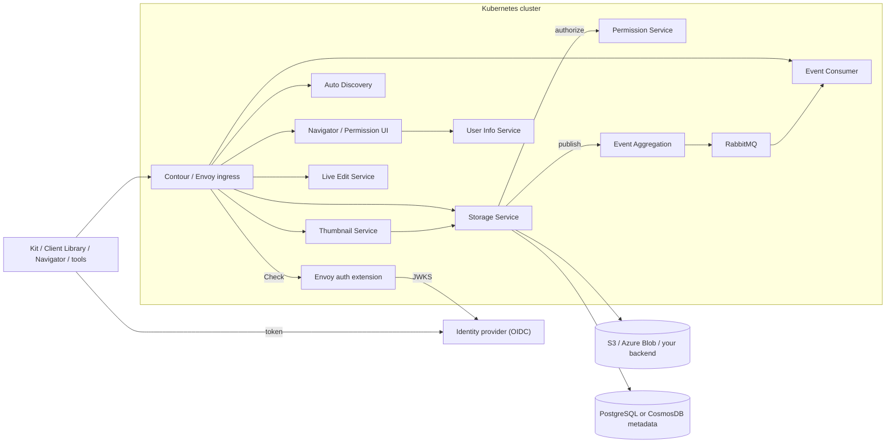

# Stack overview

> **Applies to:** the whole stack · **Released:** usd-content-workspace Developer Guide 1.3.0 inventory ([../versions/released-inventory.md](../versions/released-inventory.md)) · **This repo's snapshot:** see [../versions/source-snapshot.md](../versions/source-snapshot.md) · **Sources:** the [source skill package](../../NOTICE.md); this repo's area READMEs and component docs

Omniverse Content Services is a set of gRPC and REST API specifications plus services that implement them on top of existing storage and identity infrastructure. Kit applications, the Client Library, Storage Navigator, and your own tools reach content through these APIs instead of through a single monolithic server.

**The services here are reference implementations.** The API contracts are what clients depend on; each service can be kept, extended, or replaced by your own implementation to integrate tightly with your infrastructure. Deployments are modular: start with Discovery and Storage, and add services as workflows need them. See [replaceable-and-modular.md](replaceable-and-modular.md).

## Terms

| Term | Meaning here |
| --- | --- |
| API (contract) | A versioned gRPC and REST specification in an `api/` directory, for example the Storage API. |
| Service, or adapter | A deployable implementation of one or more APIs, for example the Storage Service, which adapts S3 or Azure Blob to the Storage API. |
| Reference implementation | NVIDIA's implementation shipped as source in a `reference/` directory. You can deploy it, extend it, or replace it with your own. |
| Client application | Anything that calls the APIs: Kit, the Client Library, Storage Navigator, scripts. |
| Deployment | A specific set of services and their exact versions and configuration in one cluster. Always record its versions ([../versions/capture-a-deployment.md](../versions/capture-a-deployment.md)). |

## Request path

1. A client obtains a token from the organization's identity provider.
2. It calls the Discovery catalog (`GET /api/v2/services`) to learn which services exist, which API versions they serve, and where they are.
3. It calls the selected service through the ingress. Contour's Envoy asks the Envoy auth extension to validate the bearer token before forwarding.
4. The Storage Service performs the operation against the backend, asks the Permission Service to authorize it when permissions are enabled, and publishes change events.
5. Event Aggregation writes events to RabbitMQ; Event Consumer delivers them to subscribed clients, including durable queues.
6. Thumbnail and Live Edit services build on Storage and Discovery for previews and live collaboration.

## Components

| Area | API in this repo | Reference service(s) | Role | Detail |
| --- | --- | --- | --- | --- |
| Discovery | [`discovery/api`](../../../../discovery/api/) | Auto Discovery operator; legacy static chart | Single entry point; advertises services and API versions | [../deploy/discovery.md](../deploy/discovery.md), [../apis/discovery.md](../apis/discovery.md) |
| Storage | [`storage/api`](../../../../storage/api/) | Storage Service (S3, Azure Blob); Python filesystem example | Files, folders, versions, metadata | [../deploy/production-stack.md](../deploy/production-stack.md), [../apis/storage.md](../apis/storage.md) |
| Metadata | [`metadata/api`](../../../../metadata/api/) | served by Storage Service 1.2.3+ | Top-level metadata API | [../apis/metadata.md](../apis/metadata.md) |
| Notifications | [`notifications/api`](../../../../notifications/api/) | Event Aggregation, Event Consumer, RabbitMQ | Change events and durable subscriptions | [../deploy/notifications.md](../deploy/notifications.md), [../apis/notifications.md](../apis/notifications.md) |
| Permissions | protos and OpenAPI in [`permission-service`](../../../../permissions/reference/permission-service/) | Permission Service, Envoy auth extension, Permission UI | Authentication at the edge; Cedar policy decisions | [../deploy/permissions-and-auth.md](../deploy/permissions-and-auth.md), [../apis/permissions.md](../apis/permissions.md) |
| User identity | protos and OpenAPI in [`microsoft-graph-userinfo-service`](../../../../user-identity/reference/microsoft-graph-userinfo-service/) | Microsoft Graph User Info Service | Users, groups, display names | [../deploy/userinfo.md](../deploy/userinfo.md), [../apis/userinfo.md](../apis/userinfo.md) |
| Thumbnails | protos and OpenAPI in [`thumbnail-service`](../../../../thumbnails/reference/thumbnail-service/) | Thumbnail Service and workers | Generated previews | [../deploy/thumbnails.md](../deploy/thumbnails.md), [../apis/thumbnails.md](../apis/thumbnails.md) |
| Live Edit | not in this repo | released Live Edit Service 0.1.1; client and service source in [ovlive](https://github.com/NVIDIA-Omniverse/ovlive) (`client/`, `service/`) | Live USD layer collaboration | [../deploy/live-edit.md](../deploy/live-edit.md), [../apis/live-edit.md](../apis/live-edit.md) |
| Clients | — | Navigator UI in [`examples/`](../../../../examples/) | Browse, upload, manage files | [../deploy/navigator.md](../deploy/navigator.md) |
| Shared libraries | — | [`common/observability`](../../../../common/observability/), [`common/url-normalizer`](../../../../common/url-normalizer/) | Telemetry and address normalization used by Rust services | [../components/common-libraries.md](../components/common-libraries.md) |

Ports, Helm charts, Discovery registration, and prerequisites per component are in the component maps under [../components/](../components/README.md). Ports in this stack are chart values, not constants: read them from the chart version you deploy.

## Deployment shapes

Two independent choices define a deployment:

- **Service stack:** the example stack (Python filesystem adapter plus Discovery) for learning and adapter development, or the production stack (Storage Service on S3 or Azure plus Discovery), adding notifications, authentication, permissions, identity, Navigator, thumbnails, and Live Edit as needed. See [choosing.md](choosing.md).
- **Runtime target:** any conformant Kubernetes distribution — MicroK8s or kind for local work, EKS, AKS, GKE, or on-premises clusters — or, optionally, ordinary local processes with no Kubernetes at all ([../deploy/local-process.md](../deploy/local-process.md)). The stack choice does not depend on the target.

## Licenses

Every NVIDIA-authored component, including the Envoy auth extension and the Thumbnail Service, is released under Apache-2.0 (see each component's `LICENSE` or `LICENSE.txt`). Vendored third-party code, such as the MIT-licensed Azure SDK fork, keeps its own license; see [`THIRD_PARTY_NOTICES.md`](../../../../THIRD_PARTY_NOTICES.md). Check the notices before redistributing a component or its images.
