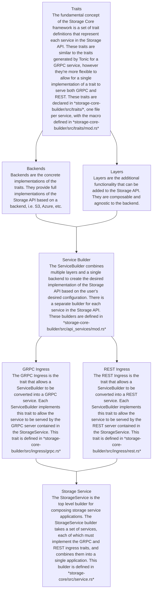

# Storage Core Architecture

Storage Core is a framework for building storage services the implements the Storage API. It is designed to be flexible and extensible, allowing developers to build storage services that are tailored to their needs.

## Core Components

### Storage Service

The StorageService is the top level builder for composing storage service applications. It is responsible for composing the storage service application from a set of layers and a backend.

### Storage Backend

The Storage Backend is the component that provides the storage functionality. It is responsible for providing concrete implementations of the Storage API, i.e. S3, Azure, etc.

### Storage Layers

The Storage Layers are a set of components that add additional functionality to the storage service. They are composable and agnostic to the backend.


## Crate Structure

### storage-core

The `storage-core` crate is the main crate of the Storage Core framework. It re-exports the necessary components from `storage-core-builder`, and provides off-the-shelf implementations of the S3 and Azure storage backends as well as a set of layers for common functionality. This is the primary crate to use when building a storage service.

### storage-core-util

The `storage-core-util` crate contains utility functions and types that are used by the `storage-core` crate. It is a separate crate to allow for reuse of the utility functions and types in other projects.

### storage-core-builder

The `storage-core-builder` crate contains the traits and builders for building storage services. Applications should not need to use this crate directly, but the storage trait declarations live here (`storage-core-builder/src/traits/`), so adding or changing a trait method happens in this crate; see [Trait method conventions](#trait-method-conventions).

### storage-core-proto

The `storage-core-proto` crate contains the protobuf definitions for the Storage API. It is a separate crate to allow for reuse of the protobuf definitions in other projects.

## Architecture

The following diagram shows the architecture of the Storage Core framework:



## Trait method conventions

Each storage trait mirrors one proto service at one API version, and each trait method mirrors one RPC of that service. The traits are declared with the `generate_storage_trait!` macro in `storage-core-builder/src/traits/<service>.rs`; the macro, the `Request` wrapper and the signature checks are in `storage-core-builder/src/traits/mod.rs`. Every backend, every layer, every test double and every downstream crate that implements or wraps a trait (storage-service included) copies its method signatures, so follow these conventions whenever you add or change a method.

### Method shape

```rust
generate_storage_trait! {
    FileObject {
        // rpc IsReadOnly(IsReadOnlyRequest) returns (IsReadOnlyResponse);
        async fn is_read_only(&self, request: Request<IsReadOnlyRequest>) -> Result<IsReadOnlyResponse>;
        // rpc Enumerate(EnumerateRequest) returns (stream EnumerateResponse);
        async fn enumerate(
            &self,
            request: Request<EnumerateRequest>,
            streaming: StreamingOptions,
        ) -> Result<BoxStream<EnumerateResponseWithContinueToken>>;
    }
}
```

- The first parameter after `&self` is `request: Request<FooRequest>`: the whole request message of the RPC, wrapped in `storage_core_builder::traits::Request`. For the client-streaming `Write` RPC the request is `WriteParameters` and the body arrives separately (see below).
- The return type is `Result<FooResponse>`, or `Result<BoxStream<..>>` for a server-streaming RPC. Paginated streams return a local wrapper such as `EnumerateResponseWithContinueToken`, defined beside the trait, that adds the continuation token to the proto response.
- The method name is the RPC name in snake case: `IsReadOnly` is `is_read_only`, `GetOptimisticLockingSupport` is `get_optimistic_locking_support`. `Move` is `move_object` because `move` is a keyword.

### Where per-request context goes

`Request<T>` wraps `tonic::Request<T>`, so besides the message it carries the caller's metadata and a typed extension map. Per-request context travels there, never as a method parameter:

| Context | Where it lives | Written by | Read by |
|---|---|---|---|
| Caller metadata: gRPC metadata or HTTP headers, including credentials and tracing headers | `request.metadata()` | The ingress. gRPC handlers pass the tonic request through with `request.into()`; REST handlers build it with `MetadataMap::from_headers(headers)`. | `AdditionalHeaderManager::parse` (tracing headers), and downstream layers that authorize the caller |
| `AdditionalHeaders` | `request.extensions()` | The `additional_headers` layer | Backends, which take it with `request.extensions_mut().remove::<AdditionalHeaders>()` and send it on the outbound call |
| `CacheControl` | `request.extensions()` | Layers that need a fresh read. Today only `manifest` does this: it inserts `CacheControl::NoCache` on its own `.manifest` reads and on caller requests addressed to a `.manifest` object, which it forwards | The cache layers below (`stat_cache`, `list_cache`, `small_object_cache`), which delegate straight to `self.inner` when `bypasses_cache()` is true |
| A cached `ResourceInfo` | `request.extensions()` | `stat_cache` and `list_cache` on `read_from_address`, `small_object_cache` on `read`, and `stat_cache` on v1alpha `move_object` | `small_object_cache` on `read_from_address`, and the backends: the S3 and Azure `read` and `read_from_address` take it with `request.extensions_mut().remove::<ResourceInfo>()` and use it instead of issuing their own stat, and v1alpha `move_object` uses it as the source version |

A layer that derives context inserts it with `request.extensions_mut().insert(..)` and passes the same request to `self.inner`. For reference, `is_read_only` in the `additional_headers` layer (`storage-core/src/additional_headers/fileobject/v1alpha.rs`) runs `self.parse(&request)?` and inserts the result, and `stat` in the S3 backend (`storage-core/src/s3/fileobject/v1alpha.rs`) removes it again.

### Sub-requests

When a layer issues a call of its own, such as the manifest layer reading a `.manifest` or the metadata key router fanning a request out, build the sub-request from the incoming request's parts so the caller's metadata and context travel with it:

```rust
let mut extensions = request.extensions().clone();
extensions.insert(CacheControl::NoCache);
let read_request: Request<ReadFromAddressRequest> = tonic::Request::from_parts(
    request.metadata().clone(),
    extensions,
    ReadFromAddressRequest { resource_address: manifest_path, ..Default::default() },
)
.into();
```

Precedents: `read_manifest_v1alpha` in `storage-core/src/manifest/fileobject/v1alpha.rs` and `update_metadata_batch` in `storage-core/src/metadata_key_router/metadata/v1alpha.rs`. Only the ingress creates a request from nothing. Below it, `Request::new`, `MetadataMap::new()`/`default()` and `Extensions::new()`/`default()` drop the caller's credentials and headers without any error.

### Extra parameters

These are the only parameters allowed after the request, and none of them carries request context:

- `streaming: StreamingOptions`: pagination for the streaming list and enumerate methods.
- `data_future: BoxFuture<Bytes>`: the deferred body of `FileObject::write`.
- `version_id_token: Option<String>`: `Versioning::enumerate_versions` only. It predates this convention and is grandfathered; do not add new `Option<String>` parameters.

Anything else requires widening the `StorageTraitExtraArg` allowlist in `traits/mod.rs`, which needs a reviewer's agreement. Request fields belong in the request message, and per-request context belongs in the metadata or the extensions.

### A method with no RPC

First confirm that something will call it: a method with no RPC gets no gRPC or REST handler, so only code inside the process can reach it. If it still belongs on the trait, define its request and response structs next to the trait in the same `traits/<service>.rs`, named after the RPC it would be, and still take `Request<ThatRequest>` so that metadata and extensions travel with it. When the proto later gains the RPC, delete the local structs: a local item silently shadows a glob-imported proto type of the same name.

### A method that lacks context

If an existing method turns out to need context it was not given, change it to take the whole `Request<FooRequest>` and return `Result<FooResponse>`. Do not add a parameter. Both are breaking changes for every implementation, but the first is made once, while the second recurs with each new piece of context.

`Versioning::is_versioning_enabled` is the example:

- storage-core-builder 0.6.4 added `is_versioning_enabled(&self, top_level_address: &str, additional_headers: Option<AdditionalHeaders>) -> Result<bool>` to the v1alpha and v1beta traits. With no request to parse, the `additional_headers` layer parsed a fabricated `Request::new(())`, so the caller's tracing headers never reached the backend, and the manifest layer's cold `.manifest` read went out with empty metadata, which fails on resolver chains that enforce permissions.
- storage-core-builder 0.8.0-alpha.1 fixed the credentials by adding `metadata: MetadataMap` to the v1alpha signature, a public change threaded through both handlers and every implementation. In the same review round, the equivalent fix for `is_read_only`, which already took a `Request`, was a two-line forward of `request.metadata()` inside the manifest layer, shipped in storage-core 0.11.0-alpha.1.
- The method was then replaced by `is_versioned(&self, request: Request<IsVersionedRequest>) -> Result<IsVersionedResponse>`, which mirrors the `IsVersioned` RPC, and the v1beta method, which had no RPC, was removed.

### Enforcement

- At compile time, `generate_storage_trait!` requires each method's first parameter to implement `StorageTraitRequest`, which only `Request<T>` does, and each further parameter to implement `StorageTraitExtraArg`, the allowlist above. Both traits are sealed, so other crates cannot widen them. A violation is an E0277 error pointing at the offending parameter. The `compile_fail` doctests in `traits/mod.rs` pin the policy; nextest skips doctests, so run them with `cargo test --workspace --doc --all-features --locked`.
- `storage-core/tests/no_fabricated_request_context.rs` parses `storage-core/src` and the gRPC handlers (`grpc.rs` under `storage-core-builder/src/api_services/`) and fails on `MetadataMap::new`/`default`, `Extensions::new`/`default` and `Request::new` outside test code. It skips the REST handlers, which build the first request from the HTTP request. A site that does need an empty value says why on the same line: `// fabricated-context: allow(<reason>)`.
- Neither check sees return types, so a method returning `Result<bool>` still compiles. Review has to catch that.
