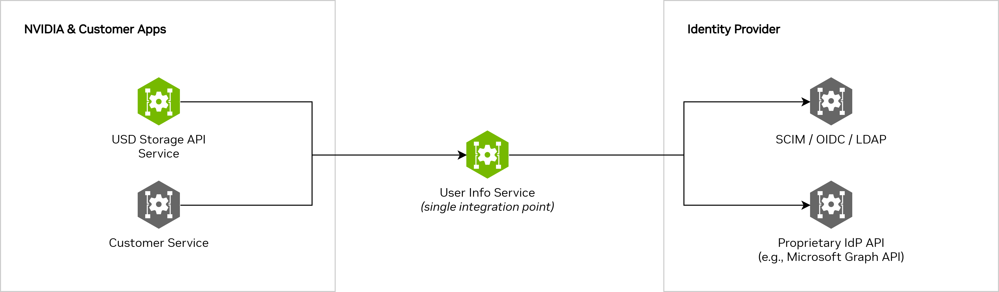
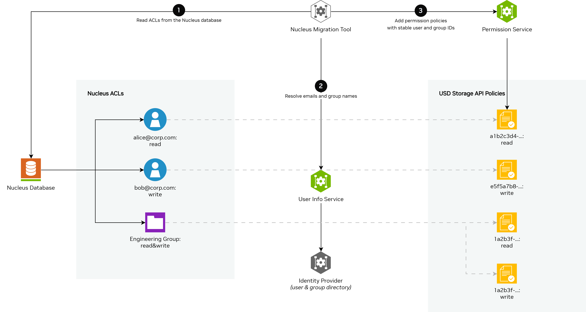
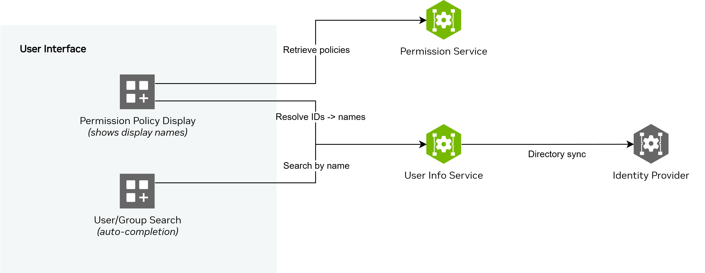

(userinfo-api-use-cases-title)=
# Use Cases

(userinfo-api-use-cases-why-it-is-needed)=
## Why it is needed

Three recurring problems in the Omniverse cloud platform motivate this service.

---

(userinfo-api-use-cases-use-case-1)=
### Use Case 1 — Centralized user information retrieval

Omniverse deployments SHALL provide a centralized mechanism for directory-backed user and group information retrieval. Platform services and externally developed services MUST be able to identify the current user, resolve user and group identifiers into human-readable attributes, search the organization directory, and obtain group membership information through a single platform interface.

Application services MUST NOT rely on direct parsing of access tokens as their source of directory information. Per [OpenID Connect](https://openid.net/specs/openid-connect-core-1_0.html#AccessTokens), access tokens are opaque to resource servers. Their internal structure is an implementation detail of the authorization server and MUST NOT be treated as a stable contract for application logic. Any design that depends on decoding token claims for directory data is provider-dependent and may break across identity provider changes, token format changes, provider upgrades, or deployment-specific configuration changes.

Application services MUST also assume that token contents are time-bound snapshots rather than current directory state. Information embedded in a token at issuance time does not automatically reflect later changes to group membership, profile attributes, naming, or other administrative updates. Services that require current, authoritative directory information therefore MUST obtain that information through a directory query interface rather than from the access token itself.

This capability is required across multiple classes of platform functionality. For human-readable display, user and group identifiers frequently need to be resolved into names that can be presented in product user interfaces. For example, Storage Navigator may need to display the author of a file and the user who last modified it. Storage Navigator may also provide a permission management panel for configuring which users and groups can read or write file content; that panel MUST be able to display resolved user and group names and MUST support autocomplete so that users can efficiently search for and add new principals. Equivalent functionality is also required in the Permission Service user interface when managing authorization policies, where administrators need to search for principals, review existing policy subjects in readable form, and select new users or groups. These are directory query requirements, not token inspection requirements.

This functionality MUST be encapsulated in a dedicated shared service. Without such a service, each team would need to independently integrate with the identity provider selected by the deploying organization and independently handle provider-specific APIs, authentication models, rate limiting, pagination, schema differences, and synchronization behavior. The platform therefore requires a single shared service that hides identity-provider-specific complexity behind a uniform interface.

(userinfo-api-use-cases-idp-retrieval)=
#### How user information is retrieved from identity providers

There are two broad approaches to querying an identity provider for user and group data: proprietary APIs and open standards.

**Proprietary APIs** are provider-specific interfaces for reading the full organizational directory. Microsoft Entra ID exposes the [Microsoft Graph API](https://learn.microsoft.com/en-us/graph/overview), Okta provides the [Okta Management API](https://developer.okta.com/docs/api/), and Google Workspace offers the [Admin SDK Directory API](https://developers.google.com/admin-sdk/directory/v1/guides). These APIs provide the richest functionality — full user and group listings, membership queries, filtering, and incremental (delta) synchronization — but each has its own authentication model, query syntax, data schema, pagination scheme, and rate-limiting behavior. Code written for one provider's API does not transfer to another.

**Open standards** offer a degree of provider independence, but each comes with trade-offs:

- **SCIM 2.0** ([RFC 7644](https://datatracker.ietf.org/doc/html/rfc7644)) — System for Cross-domain Identity Management defines a standard REST API for querying and managing users and groups. In theory, a single SCIM integration could work across any compliant provider. In practice, SCIM support varies: some providers implement it fully, others only partially, and the filtering and pagination capabilities differ between implementations.

- **OpenID Connect UserInfo** ([OpenID Connect Core §5.3](https://openid.net/specs/openid-connect-core-1_0.html#UserInfo)) — The UserInfo endpoint returns profile information about the currently authenticated user. However, it is limited to the single user associated with the access token. It cannot list other users, search the directory, or resolve group memberships — all of which are required for authorization policy management.

- **LDAP** ([RFC 4511](https://datatracker.ietf.org/doc/html/rfc4511)) — The Lightweight Directory Access Protocol is the traditional standard for directory queries in on-premises environments. Most cloud identity providers do not expose LDAP directly, and LDAP's connection-oriented protocol model is not well suited to cloud-native service architectures.

In practice, most deployments require a proprietary API integration (such as Microsoft Graph) to get the full directory query, search, and synchronization capabilities that Omniverse services need.

(userinfo-api-use-cases-encapsulation)=
#### Why this complexity must be encapsulated in a dedicated service

Regardless of which approach is used, integrating with an identity provider for directory-level queries involves substantial complexity:

- **Directory synchronization.** Serving user lookups and search queries with acceptable latency usually means keeping a synchronized copy of the directory rather than querying the provider on every request. Keeping that copy current involves both an initial full synchronization and an ongoing incremental (delta) synchronization to capture changes — new users, updated profiles, disabled accounts, modified group memberships — without re-reading the entire directory every time.

- **Pagination.** Organizational directories can contain tens or hundreds of thousands of users and groups. Provider APIs return results in pages, and the calling service must correctly walk through all pages, handle continuation tokens, and deal with pages that expire or become invalid mid-sync.

- **Rate limiting and throttling.** Identity provider APIs enforce request rate limits. Microsoft Graph, for example, throttles at the tenant level and returns HTTP 429 responses with a `Retry-After` header. The integration must respect these limits, implement backoff-and-retry logic, and avoid overwhelming the provider — especially when multiple services share the same tenant.

- **Transient failure handling.** Network errors, provider outages, and timeout responses (HTTP 503, 504) are routine in cloud-to-cloud communication. Robust retry strategies with exponential backoff and jitter are necessary to maintain reliability without amplifying failures.

- **Credential management.** Service-to-provider authentication typically uses client credentials (client ID and secret, or certificates). These credentials must be securely stored, rotated on schedule, and used to acquire and refresh short-lived access tokens.

- **Data model differences.** Each identity provider returns user and group data in a different schema. Field names, nesting structures, optional versus required fields, and date formats vary between providers. The integration must normalize provider-specific responses into a consistent data model for consuming services.

- **Group membership resolution.** Some providers return only direct group memberships; others support transitive membership queries (groups within groups). The integration must handle whichever model the provider uses and present a consistent view of membership to callers. User Info Service defines a **direct membership** contract: all membership endpoints MUST report only groups that a user is directly assigned to, not groups inherited through nesting.

Independent implementation of identity provider integration across multiple services — whether developed by NVIDIA or externally — would result in duplicated effort, inconsistent behavior, and competing rate-limit consumption against shared tenant quotas. Each implementation would independently bear the full cost of directory synchronization, failure handling, credential management, and data model normalization. Changes to the identity provider's API or migration to a different provider would require coordinated updates across all affected services. Externally developed services would additionally be required to implement and maintain identity provider integration logic as a prerequisite for extending the platform.

User Info Service MUST provide a single, centralized integration point with the organization's identity provider. The service MUST encapsulate all directory synchronization, rate-limit management, credential handling, and data normalization logic, and MUST expose a uniform query API for user and group information. All services operating within the Omniverse platform — both NVIDIA-provided and externally developed — MUST retrieve user and group data exclusively through User Info Service, without direct dependency on the underlying identity provider. The identity provider MUST be configured once per platform deployment, and all services MUST benefit from this configuration without additional per-service setup.

---

(userinfo-api-use-cases-use-case-2)=
### Use Case 2 — Stable user identifiers for authorization policies

NVIDIA Nucleus uses Access Control Lists (ACLs) to manage permissions on every file and directory. Each ACL entry granted a principal — either a user or a group — one of three permission levels: read, write, or admin. Nucleus identified users by their email addresses and groups by their display names.

As Nucleus workloads migrate to Omniverse Storage API, these ACLs must be migrated as well. The migration must convert every principal reference from an email or group name to a stable identity provider identifier. The same requirement may also apply to related metadata that stores user identity in a human-oriented form, such as file author fields, modified-by fields, or checkpoint metadata. However, email addresses are fundamentally unsuitable as stable user identifiers in systems that rely on identity providers. There are several reasons:

- **Emails are mutable.** Users change their names (and therefore their email addresses) due to marriage, legal name changes, or corporate domain migrations. When an email changes, any authorization policy referencing the old address silently breaks — the user loses access with no error or audit trail.

- **Emails are not guaranteed unique across accounts.** In some identity providers, multiple accounts can share the same email address (e.g., shared mailboxes, guest accounts, or accounts across merged tenants). Using email as an identifier can inadvertently grant access to the wrong principal.

- **Emails are provider-dependent.** The format and lifecycle of email addresses varies between identity providers. An organization that switches providers (e.g., from on-premises Active Directory to a cloud identity service) may see email addresses change format or disappear entirely.

Every major identity provider explicitly warns against using email as a stable identifier and recommends using the provider-assigned unique identifier instead:

| Identity Provider | Stable Identifier | Recommendation |
|---|---|---|
| **Microsoft Entra ID** | `id` (object ID, a GUID) | Microsoft's identity platform documentation states: *"Do not use email or UPN as a stable identifier — use the immutable `oid` or `sub` claim."* See [Microsoft identity platform best practices](https://learn.microsoft.com/en-us/entra/identity-platform/id-token-claims-reference). |
| **Okta** | `uid` (unique user ID) | Okta's developer documentation recommends using the `uid` claim from tokens rather than email. See [Okta token claims reference](https://developer.okta.com/docs/reference/api/oidc/#token-claims-for-openid-connect). |
| **Google Identity** | `sub` (subject identifier) | The OpenID Connect specification used by Google defines `sub` as the stable, never-reassigned user identifier. Google's documentation states that `sub` should be used instead of email. See [Google Identity — OpenID Connect](https://developers.google.com/identity/openid-connect/openid-connect). |

User Info Service MUST provide the resolution capability required to convert email-based and name-based ACLs into identifier-based authorization policies. The service MUST resolve user email addresses to their corresponding stable identity provider identifiers and MUST resolve group display names to their corresponding stable identity provider group identifiers. The migration process itself is outside the scope of User Info Service; however, any migration workflow MUST be able to use this service as the source of truth for principal resolution. The same resolution capability SHOULD be used for related metadata that refers to users by email or name, including authorship fields, modified-by fields, and checkpoint records. The resolution MUST cover both principal types in the Nucleus ACL model — individual users and groups — such that migrated policies and other migrated identity-bearing metadata reference exclusively immutable, provider-assigned identifiers. Migrated data MUST remain valid regardless of subsequent email changes, group renames, domain migrations, or identity provider switches.

---

(userinfo-api-use-cases-use-case-3)=
### Use Case 3 — Human-readable display and auto-completion for user interfaces

Authorization policies stored in Omniverse Storage API reference users and groups by their identity provider identifiers — opaque strings like `a1b2c3d4-e5f6-7890-abcd-ef1234567890`. These identifiers are not suitable for direct presentation to administrators. User interfaces that display or configure access control policies MUST translate these identifiers into human-readable properties such as display names, email addresses, and job titles.

This requirement applies to multiple product surfaces. Storage Navigator may need to display who authored a file and who last modified it, which requires resolving stored user identifiers into readable names. Storage Navigator may also expose a permission panel for configuring which users and groups can read or write file content. That panel MUST display existing principals in human-readable form and MUST allow administrators to search for and add new principals without knowing their identifiers in advance. The same capability is required in the Permission Service user interface when administrators manage authorization policies and need to review, search for, and select users and groups.

Additionally, when administrators configure access policies on Omniverse Storage files and directories, they need to find and select users and groups by name. Typing a full identifier is impractical. User interfaces therefore require auto-completion: the administrator begins typing a name, the interface searches the directory in real time, and presents matching users and groups for selection.

User Info Service MUST support both requirements:

- **Identifier-to-name resolution.** The service MUST accept user and group identifiers and MUST return the corresponding human-readable properties — including display name, email address, and job title — for presentation in user interfaces.

- **Name-based search and auto-completion.** The service MUST accept partial name input and MUST return matching users and groups using prefix and substring matching. User interfaces MUST use the returned stable identifiers when storing principal references in authorization policies.

Authorization policies MUST reference stable identifiers exclusively. User interfaces MUST use User Info Service to translate between opaque identifiers and human-readable representations, ensuring that the authorization model remains correct while the administrative experience remains intuitive.

(userinfo-api-use-cases-directory-access-unavailable)=
## When directory access for User Info Service is unavailable

An organization might be unable to grant User Info Service the access it needs to the identity provider to read and synchronize user and group information. That situation must not, by itself, prevent the organization from deploying Omniverse Storage APIs.

Organizations may still operate the platform by providing another implementation of the same user- and group-information APIs (or an equivalent integration that satisfies dependent components), or by not using features that rely on the capabilities described under {ref}`Why it is needed <userinfo-api-use-cases-why-it-is-needed>`, where that trade-off is acceptable for their deployment.

(userinfo-api-use-cases-see-next)=
## See next

* {ref}`Directory synchronization and data freshness <userinfo-api-directory-synchronization-title>`
