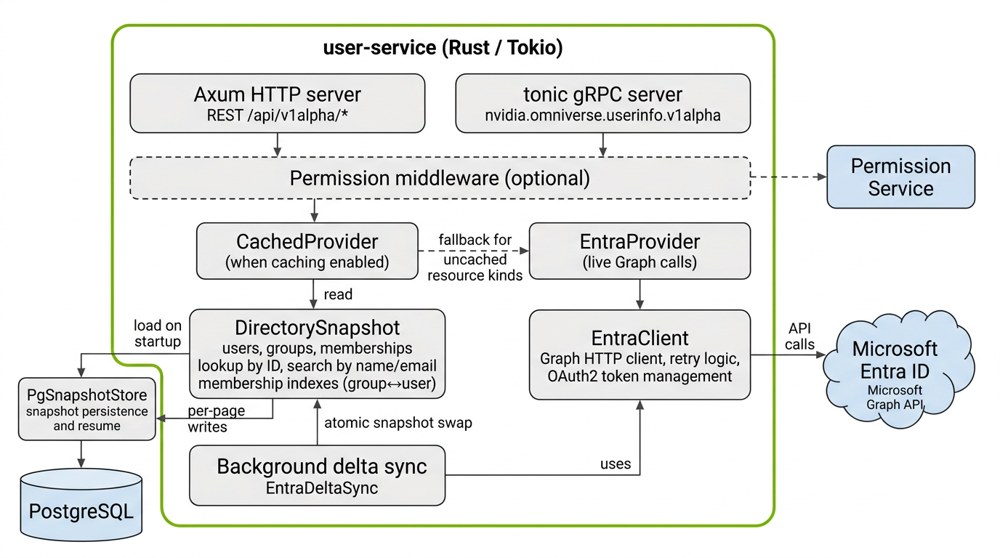
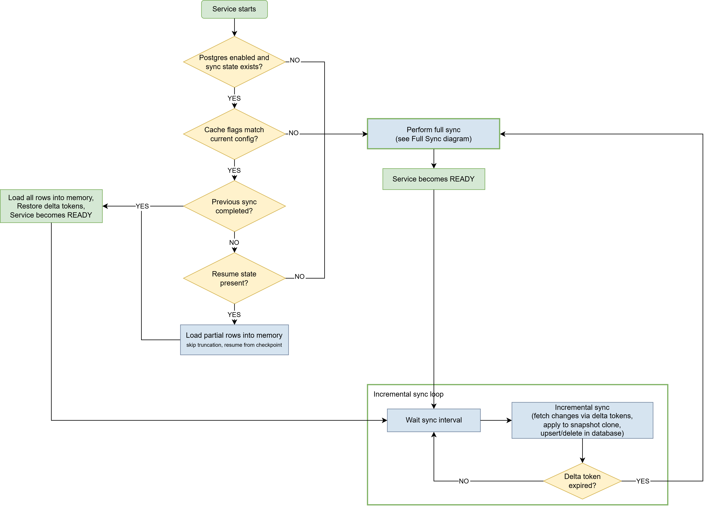
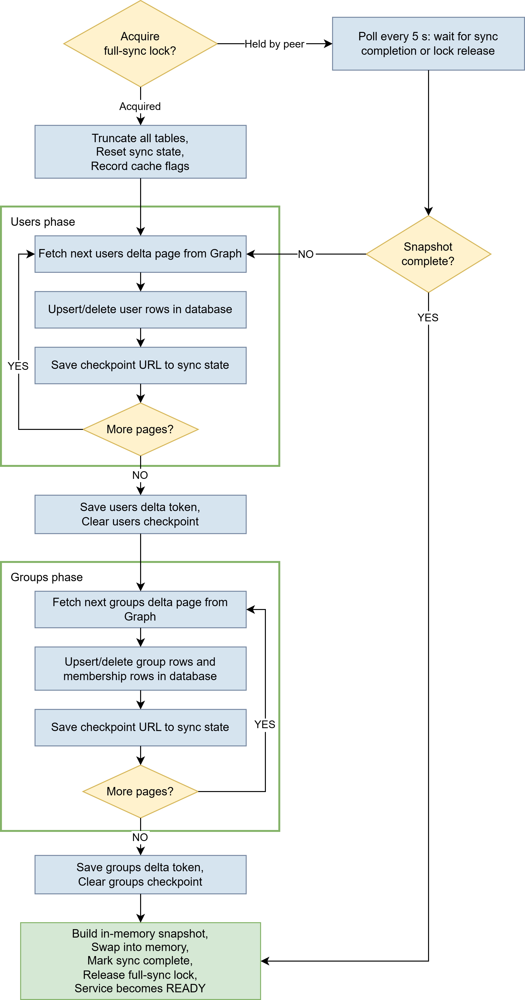

# User Info Service — Software Design Document (SDD)

This document describes how the **microsoft-graph-userinfo-service** implementation realizes the product and API contract defined in the [API documentation](api/docs/index.md). It focuses on runtime behavior and internal structure rather than the external API surface, which the API documentation covers authoritatively.

---

## Implementation

### Purpose

User Info Service is a read-only identity abstraction over the organization's identity provider (currently Microsoft Entra ID). It maintains a continuously synchronized local replica of the directory and exposes user/group lookups, searches, and membership queries through uniform REST and gRPC APIs. The high-level motivations — centralized identity retrieval, stable identifiers, UI autocomplete — are described in the [API documentation](api/docs/index.md); this section covers how the service is built to satisfy them.

The main service implementation lives in the Rust crate `crates/microsoft-graph-userinfo-service/`; the repository root is a Cargo workspace (`Cargo.toml`, `Cargo.lock`) that includes this crate and supporting tools such as `crates/microsoft-graph-userinfo-publishing/`.

### Architecture

The service runs as a single Rust process on Tokio. Internally it is structured as a pipeline of layered components, each with a specific responsibility. The diagram below shows the components and the data flow between them.

The process starts in one of two modes, selected by the startup mode setting (environment variable `STARTUP_MODE`, default `reader`):

- **Writer.** Continuously synchronizes the directory from Microsoft Entra ID into the shared PostgreSQL snapshot store. It exposes only the health and readiness probes and does not serve the read APIs. Writer mode requires caching and PostgreSQL persistence.
- **Reader.** Serves the REST and gRPC read APIs. With caching enabled it loads the snapshot from PostgreSQL into memory and reloads it on a fixed interval, never contacting Graph for synchronization; with caching disabled it serves every request live from Microsoft Entra ID. Reader mode never writes to the snapshot store.

Writers and readers are deployed as separate workloads. This separates the write path from the horizontally scalable read path and removes the need to block serving replicas on synchronization before they start. The read path scales out by adding reader replicas. The write path does not scale: the directory sync is sequential and serialized by a database advisory lock, so it cannot be parallelized, and the writer therefore always runs as a single replica.



**API layer.** Two servers run concurrently in the same process: an Axum HTTP server exposing the REST surface under `/api/v1alpha/*`, and a tonic gRPC server implementing `nvidia.omniverse.userinfo.v1alpha`. Both delegate to the same provider trait, so behavior is identical across interfaces.

**Service discovery (CapabilitiesService).** The gRPC server additionally implements the Omniverse discovery `CapabilitiesService` so that discovery clients scanning by the `userinfo` service type can enumerate the public APIs at runtime. Its `ListServices` response is static metadata: a single service entry advertising the gRPC `UserInfoService` and the REST `userinfo` endpoint at version `v1alpha`. The advertised gRPC service name is taken from the generated service descriptor and the REST version from the single source of truth shared with the REST route declarations, so the advertisement cannot drift from the served surface. The capabilities API carries no directory data, is exempt from authentication, and reports a serving health status independent of directory readiness. Its message and server types are generated from the external discovery schema into a dedicated proto crate with committed sources.

**Permission middleware.** When enabled, intercepts every request on both interfaces, forwards the caller's Bearer token to the Permission Service, and enforces allow/deny decisions. An in-memory cache keyed by a hash of (token, action, resource) avoids repeated round-trips. List responses go through a post-filter pass that batch-checks each item and removes denied entries before returning. See the [Permission middleware](#permission-middleware) section for full details.

**CachedProvider.** Active only when caching is enabled. It reads from the in-memory `DirectorySnapshot` for resource kinds that have caching turned on (users, groups, memberships are independently configurable). For resource kinds where caching is disabled, it falls back to `EntraProvider` for a live Graph call. The same component backs both modes: in a writer the snapshot is maintained by the background delta sync, while in a reader it is populated by periodically reloading the snapshot from PostgreSQL. The `/me` endpoint is a special case: the `oid` claim is always decoded from the caller's JWT. When user caching is on, the ID is resolved against the snapshot; when user caching is off, it is looked up via `GET /users/{oid}` against Graph using the application's own credentials. When caching is entirely disabled, all requests go directly through `EntraProvider`.

**DirectorySnapshot.** An in-memory replica of the organization's directory, containing users, groups, and group-to-user memberships. It supports lookup by ID, search by display name or email (prefix and substring matching), and bidirectional membership resolution through group→user and user→group indexes. All list pagination is performed locally using opaque keyed cursors (encoding the last-seen entity ID), which avoids any dependency on Graph pagination tokens at query time and remains stable across snapshot swaps. The snapshot is protected by a read-write lock and replaced atomically — by the background sync task in a writer, or by the periodic reload in a reader.

**EntraProvider.** A thin adapter that translates `IdentityProvider` trait calls into Microsoft Graph HTTP requests via `EntraClient`. It serves as the live fallback for resource kinds where caching is disabled, and handles all requests when caching is entirely off.

**EntraClient.** The HTTP client for Microsoft Graph, used by both `EntraProvider` and the background delta sync. Every request goes through a retry loop: 429 responses respect the `Retry-After` header (with jitter), 503/504 use exponential backoff, and all other errors fail immediately. The client manages its own OAuth2 client-credentials token, refreshing it as needed.

**Background delta sync (EntraDeltaSync).** A background task, running only in writer mode, that periodically synchronizes the directory with Microsoft Entra ID using delta queries. On the first run it performs a full sync; subsequent runs fetch only changes. The sync lifecycle is described in detail in the [Directory caching](#directory-caching) section.

**PgSnapshotStore (PostgreSQL snapshot store).** When enabled, four tables (`users`, `groups`, `group_members`, `sync_state`) persist the directory replica and sync progress. On startup the service loads from Postgres and becomes ready immediately (typically seconds) instead of waiting for a full Graph sync. During sync, each fetched page is written to Postgres as it arrives, with resume checkpoints (`@odata.nextLink`) saved after each page — so a crash mid-sync does not discard partial progress. The schema is auto-created and auto-migrated on startup; no external migration tooling is required. `PgSnapshotStore` implements the `SnapshotStore` trait, making the persistence backend pluggable.

### Permission middleware

The service optionally integrates with the Omniverse Storage Permission Service to enforce per-endpoint authorization. The feature is disabled by default and activated by setting the `PERMISSION_ENABLED` environment variable to `true` along with `PERMISSION_URL` pointing to the Permission Service base URL.

#### How it works

The middleware intercepts every API request on both interfaces (REST and gRPC) before the request reaches the handler. It performs the following steps:

1. **Action mapping.** The endpoint being called is mapped to a named authorization action. Get-by-ID endpoints additionally include a resource descriptor containing the entity type and identifier. List endpoints use a pre-request action to authorize the listing itself, and a separate post-filter action checked against each returned item.

   | REST endpoint | gRPC RPC | Pre-request action | Resource | Post-filter action |
   |---|---|---|---|---|
   | `GET /users` | `ListUsers` | `list-users` | — | `get-user` per item |
   | `GET /users/{userId}` | `GetUser` | `get-user` | User | — |
   | `GET /users/{userId}/groups` | `ListUserGroups` | `list-user-groups` | User | `get-group` per item |
   | `GET /users/{userId}/groups/{groupId}` | `GetUserGroup` | `get-user-group` | User | — |
   | `GET /groups` | `ListGroups` | `list-groups` | — | `get-group` per item |
   | `GET /groups/{groupId}` | `GetGroup` | `get-group` | Group | — |
   | `GET /groups/{groupId}/users` | `ListGroupMembers` | `list-group-members` | Group | `get-user` per item |
   | `GET /groups/{groupId}/users/{userId}` | `GetGroupMember` | `get-group-member` | Group | — |

2. **Pre-request check.** The action name, the configured service name (environment variable `PERMISSION_SERVICE_NAME`, default `userinfo`), and the resource (if any) are sent to the Permission Service via `POST /v1beta/authorization/`. The outgoing request carries the caller's Bearer token, from which the Permission Service determines the caller's identity; the service does not interpret or substitute the token. The Permission Service returns one of two decisions:
   - **Allow** — the request proceeds to the handler.
   - **Deny** — the request is rejected immediately with 403 Forbidden (REST) or PERMISSION_DENIED (gRPC).

3. **Post-filtering for list endpoints.** After the handler returns results, each item in the response is individually checked against the corresponding post-filter action from the table above. This is done via the Permission Service batch endpoint (`POST /v1beta/authorization/batch/`). Items the caller is not authorized to see are removed from the response before it is sent. Post-filter resource descriptors include all available entity attributes (display name, email, group description, etc.) to support attribute-based access control policies.

4. **Exempt endpoints.** Health and readiness probes (`/healthz`, `/readyz`) and the get-current-user endpoint (`/users/me`, `GetCurrentUser`) are exempt from permission checking — the probes do not expose directory data, and the current-user endpoint returns only the caller's own profile.

#### Decision caching

To reduce latency and load on the Permission Service, authorization decisions are cached in memory. The cache key is a numeric hash of the caller's token, the action, and the resource (if any) — the raw token is not stored in the cache. This means:

- A token refresh produces a cache miss, triggering a fresh check.
- Pre-request checks and post-filter checks share the same cache — a decision cached for an individual item during a list request is reused by a subsequent get-by-ID request for the same entity, and vice versa.

The SRD notes that the service MAY integrate with a notification service to listen for policy update events from the Permission Service and invalidate affected cache entries immediately rather than waiting for TTL expiry. This is not currently implemented — the service relies solely on TTL-based expiry, so permission policy changes propagate with up to `PERMISSION_CACHE_TTL` delay.

The cache is configured via two environment variables:

| Variable | Default | Description |
|----------|---------|-------------|
| `PERMISSION_CACHE_TTL` | `5m` | Time-to-live for cached decisions. Permission changes propagate within this window. |
| `PERMISSION_CACHE_MAX_CAPACITY` | `10000` | Maximum number of cached decisions. Oldest entries are evicted when full. |

#### Error handling

If the Permission Service is unreachable, returns an unexpected error, or times out, the service denies the request rather than allowing it through — no request is permitted when the authorization system is unavailable. The caller receives 500 Internal Server Error (REST) or INTERNAL (gRPC). Recognized error codes from the Permission Service are forwarded directly: a 401 becomes 401 Unauthorized, and a 429 becomes 429 Too Many Requests with the appropriate retry information.

### Microsoft Entra ID integration

The service integrates with Microsoft Entra ID (Azure AD) via the [Microsoft Graph API v1.0](https://learn.microsoft.com/en-us/graph/overview) to read directory data. Two components handle this integration: EntraClient is the low-level HTTP client responsible for authentication, request execution, and retry logic; EntraProvider is the higher-level adapter that translates service-level operations (list users, get group, check membership, etc.) into the appropriate Graph API calls.

#### Graph permissions

EntraClient uses the client credentials flow without a signed-in user, so the Entra app registration needs **Microsoft Graph application permissions** (not delegated permissions) covering users, groups, and group membership. Each of the following requires admin consent in the tenant, as described in the [Microsoft Graph permissions reference](https://learn.microsoft.com/en-us/graph/permissions-reference).

| Area | Application permission | Purpose |
| --- | --- | --- |
| Users | `User.Read.All` | Read user profiles for list/get operations and user delta sync. |
| Groups | `Group.Read.All` | Read group properties for list/get operations and group delta sync. |
| Group membership | `GroupMember.Read.All` | Read group members, user group memberships, membership checks, and group delta when membership is included in sync. |

Broader permissions such as `Directory.Read.All` also satisfy directory read scenarios; Microsoft recommends resource-specific permissions where possible instead of directory-wide permissions.

When enterprise-application app-role assignment scoping is enabled (see [Enterprise-application app-role assignment scoping](#enterprise-application-app-role-assignment-scoping)), the writer additionally reads the application's own `appRoleAssignedTo` collection. When the service authenticates as the enterprise application and queries **its own** service principal, this read succeeds without any additional application permission — a service principal may read its own application and service principal details. This behavior is relied on empirically and is **not explicitly documented** for the `appRoleAssignedTo` navigation, so the design fails closed (see the scoping section). Pointing the scope at a **different** application's service principal requires the `Application.Read.All` application permission; without it, Graph returns `403 Authorization_RequestDenied`.

#### Authentication

EntraClient authenticates to Microsoft Graph using the OAuth 2.0 [client credentials flow](https://learn.microsoft.com/en-us/entra/identity-platform/v2-oauth2-client-creds-grant-flow). It supports two credential types:

- **Client secret** — the service sends its client ID and secret to the Entra token endpoint.
- **Workload identity federation** — the service reads a Kubernetes-projected service account token from a file and sends it as a client assertion (JWT bearer). This avoids storing long-lived secrets.

In both cases the token request is sent to `https://login.microsoftonline.com/{tenant}/oauth2/v2.0/token` with `scope=https://graph.microsoft.com/.default`. The returned access token is cached in memory and reused until it approaches expiry (refreshed with a 2-minute safety margin). Under concurrency, only one token refresh is performed at a time; other callers wait for the result.

Configuration:

| Variable | Default | Description |
|----------|---------|-------------|
| `AZURE_TENANT_ID` | *required* | Entra ID tenant ID. |
| `AZURE_CLIENT_ID` | *required* | App registration client ID. |
| `AZURE_AUTH_MODE` | `client-secret` | Authentication mode: `client-secret` or `workload-identity`. |
| `AZURE_CLIENT_SECRET` | — | Client secret. Required when auth mode is `client-secret`. |
| `AZURE_FEDERATED_TOKEN_FILE` | `/var/run/secrets/azure/tokens/azure-identity-token` | Path to the Kubernetes-projected service account token file. Used when auth mode is `workload-identity`. |

#### Graph API calls

All requests are sent to the Graph v1.0 endpoint (`https://graph.microsoft.com/v1.0`). Every request includes the `ConsistencyLevel: eventual` header, which is required for `$search` and `$count` support. The `$select` parameter is always set to limit the response to the fields the service needs. Every request also includes a `client-request-id` header containing a GUID, as recommended by the [Microsoft Graph best practices](https://learn.microsoft.com/en-us/graph/best-practices-concept). Microsoft records this value in [Graph activity logs](https://learn.microsoft.com/en-us/graph/microsoft-graph-activity-logs-overview), making it useful for diagnostics and support requests.

**User fields selected:** `id`, `displayName`, `givenName`, `surname`, `mail`, `userPrincipalName`, `accountEnabled`, `jobTitle`

**Group fields selected:** `id`, `displayName`, `description`

The following table lists each Graph API call used, grouped by the service operation that triggers it.

| Service operation | Graph API endpoint | Key OData parameters |
|---|---|---|
| List users | `GET /users` | `$select`, `$top`, `$count`, `$filter` (for email exact match or display name prefix via `startsWith`), `$search` (for display name substring) |
| Get user by ID | `GET /users/{id}` | `$select` |
| Get current user | `GET /users/{oid}` | `$select` — the `oid` claim is decoded from the caller's JWT, then looked up as a regular user |
| List groups | `GET /groups` | `$select`, `$top`, `$count`, `$filter` (prefix via `startsWith`), `$search` (substring) |
| Get group by ID | `GET /groups/{id}` | `$select` |
| List group members | `GET /groups/{id}/members/microsoft.graph.user` | `$select`, `$top`, `$count`, `$filter`, `$search` |
| List user's groups | `GET /users/{id}/memberOf/microsoft.graph.group` | `$select`, `$top`, `$count`, `$filter`, `$search` |
| Check user-group membership | `GET /users/{userId}/memberOf/microsoft.graph.group` | `$filter=id eq '{groupId}'`, `$top=1` |
| Check group-member membership | `GET /groups/{groupId}/members/microsoft.graph.user` | `$filter=id eq '{userId}'`, `$top=1` |
| User delta sync | `GET /users/delta` | `$select` — initial call; subsequent pages follow `@odata.nextLink`; incremental syncs resume from `@odata.deltaLink` |
| Group delta sync | `GET /groups/delta` | `$select` (includes `members` when membership caching is enabled) — same pagination model as user delta |
| List app-role assignments (scoping) | `GET /servicePrincipals/{id}/appRoleAssignedTo` | `$select=principalId,principalDisplayName,principalType`; pages follow `@odata.nextLink`. Used only when app-role assignment scoping is enabled. |
| Resolve own service principal (scoping) | `GET /servicePrincipals(appId='{AZURE_CLIENT_ID}')` | `$select=id` — used to resolve the application's own service principal object id when none is configured. |

> **Note — token interpretation and the SRD.** The SRD (section 2.7.1) states that services "MUST NOT interpret the token or extract identity claims from it." That restriction exists to prevent identity-provider-specific knowledge from spreading across the platform — most services treat the Bearer token as opaque and delegate identity resolution to this service or authorization checks to the Permission Service. This service, however, is the central integration point with a specific identity provider (Microsoft Entra ID) whose access tokens are JWTs. Decoding claims such as `oid` is an inherent part of that integration — for example, the `/users/me` endpoint resolves the caller's identity by extracting the `oid` claim and looking up the corresponding directory user. The SRD's prohibition targets consumers of the User Info Service, not the service itself.

#### Display name filtering

When the caller provides a `display_name` filter, the service translates it into Graph OData syntax:

- **Prefix match** (value ends with `*`, e.g. `Jan*`) — translated to `$filter=startsWith(displayName,'Jan')`.
- **Substring search** (no trailing `*`) — translated to `$search="displayName:Jan"`.

Single quotes in user-provided values are escaped for OData (`'` → `''`).

#### Pagination

For live (uncached) queries, EntraProvider uses Graph's native `@odata.nextLink` pagination. The opaque `@odata.nextLink` URL returned by Graph is base64-encoded and returned to the caller as the `next_cursor` (REST) or `next_page_token` (gRPC). On the next request, the cursor is decoded back into the URL and called directly — all other query parameters are baked into the URL by Graph, so the service does not need to reapply them. Before the decoded URL is used, it is pinned to the endpoint of the operation that issued it: both its origin (scheme, host, and port) and its path — including any route identifiers such as the group or user id — must match the URL the operation calls for its first page. Because Graph returns same-origin, same-path `@odata.nextLink` URLs, this is transparent to legitimate pagination while preventing a caller-supplied cursor from redirecting an app-token-bearing request to another host or reusing it to read a different Graph resource (for example, another group's members). A cursor that fails these checks — or is otherwise unparseable — is a client error and is rejected with 400 Bad Request (`bad_request`) / `INVALID_ARGUMENT`, not 500.

The `$top` parameter controls page size and is capped to the caller's requested `limit` or the configured maximum page size, whichever is smaller.

> **Note on cursor content.** A decoded live cursor reveals the Graph API endpoint, `$select` fields, page size, and an opaque `$skiptoken` — but no tenant ID (the tenant is determined by the [authentication token, not the URL](https://learn.microsoft.com/en-us/graph/paging)), no request headers, and no credentials. The exposed fields correspond directly to the service's public response schema, and the use of Microsoft Graph is already documented, so the cursor does not leak sensitive information.

#### Retry logic

Every Graph API request made through EntraClient goes through a retry loop (up to a configurable maximum number of attempts, default 3, set via the `GRAPH_MAX_RETRIES` environment variable):

| Response | Strategy                                                                                    |
|----------|---------------------------------------------------------------------------------------------|
| HTTP 429 (Too Many Requests) | Reads the `Retry-After` header value in seconds, adds random jitter, sleeps, then retries. If all retries are exhausted on a 429, the error propagates up and the caller receives HTTP 429 with the `Retry-After` value from Graph's last response forwarded in the response header. |
| HTTP 503 or 504 (transient server errors) | Exponential backoff (1s, 2s, 4s, …) with jitter, up to the maximum retry count.             |
| Any other error | Not retried; returned immediately to the caller.                                            |

#### Data model mapping

Graph API responses use camelCase field names. EntraProvider maps these to the service's User and Group models on each response.

**User**

| Graph field | Service field |
|-------------|---------------|
| `id` | `id` |
| `displayName` | `display_name` |
| `givenName` | `given_name` |
| `surname` | `family_name` |
| `mail` | `email` |
| `userPrincipalName` | `username` |
| `accountEnabled` | `active` |
| `jobTitle` | `job_title` |

**Group**

| Graph field | Service field |
|-------------|---------------|
| `id` | `id` |
| `displayName` | `display_name` |
| `description` | `description` |

### Directory caching

When caching is enabled (the default), the service maintains an in-memory replica of the organization's directory and serves API responses from that replica instead of calling Microsoft Graph on every request. Caching is independently configurable for each resource kind — users, groups, and memberships can each be turned on or off. When caching is disabled for a resource kind, queries for that kind are forwarded to Graph in real time. Membership caching is off by default because it significantly increases sync time and memory usage for large directories.

The in-memory replica is built differently depending on the mode. A writer keeps it aligned with Microsoft Entra ID through the background delta sync described below. A reader does not synchronize from Graph; it loads the replica from the PostgreSQL snapshot store and refreshes it on a fixed interval (environment variable `READER_RELOAD_INTERVAL`, default 60 seconds), picking up whatever the writer has most recently persisted.

When caching is entirely disabled, all requests go through EntraProvider directly and no replica is maintained.

#### Request routing

CachedProvider sits between the API layer and the underlying EntraProvider. For each incoming request, it decides how to serve it:

- If caching is enabled for the relevant resource kind, the request is served from the in-memory DirectorySnapshot. Filtering (by email, display name prefix, display name substring) and pagination are applied locally over the snapshot data. Pagination uses opaque base64-encoded keyed cursors that encode the ID of the last item on the current page. Because all result sets are sorted by entity ID, the next page resumes from the first item whose ID is greater than the cursor value. This makes cursors stable across snapshot swaps: if a background sync replaces the snapshot between two pages of the same query, the cursor still points to the correct resumption position regardless of insertions or deletions elsewhere in the result set. The only caveat is that entities inserted before the cursor position during a swap are not seen by the in-progress query — consistent with the service's eventually-consistent data model.
- If caching is disabled for that resource kind, the request is passed through to EntraProvider, which calls Graph directly.
- The get-current-user endpoint (`/users/me`) is a special case: both paths decode the `oid` claim from the caller's JWT. When user caching is on, the ID is resolved against the snapshot. When user caching is off, the ID is looked up via `GET /users/{oid}` against Graph using the application's own credentials (not the caller's token).

#### Background delta sync

In writer mode a background task runs continuously and keeps the in-memory snapshot aligned with Microsoft Entra ID using Graph [delta queries](https://learn.microsoft.com/en-us/graph/delta-query-overview). A delta query works like a bookmark over the directory: the first call returns the full current state of the requested resource collection (e.g. all users), paginated via `@odata.nextLink` URLs. The final page includes an `@odata.deltaLink` instead — an opaque URL that encodes the point-in-time of that snapshot. On the next sync cycle, calling the `@odata.deltaLink` returns only the records that have changed (created, updated, or deleted) since that point, again ending with a new `@odata.deltaLink` for the next cycle. This avoids re-reading the entire directory on every sync.

The sync follows this lifecycle:

1. **Optional startup jitter.** If a maximum jitter duration is configured (environment variable `SYNC_JITTER_MAX`, default `0s`), the first sync is delayed by a random duration within that range. In multi-replica deployments this setting should be set to a non-zero value (e.g. `30s`) to prevent all replicas from hitting Graph simultaneously on startup, which would cause a thundering-herd of requests against the tenant's rate-limit budget.

2. **Initial full sync.** On the first cycle (no delta token), the service fetches all users via `GET /users/delta` and all groups via `GET /groups/delta`, page by page. Each page is fetched sequentially (no parallel requests), keeping the request rate low and well below Graph's throttling threshold. When membership caching is enabled, the groups delta request includes `members` in `$select`, causing Graph to return a `members@delta` array alongside each group. Page size is determined by Graph (`$top` is not supported on delta endpoints).

3. **Incremental syncs.** On subsequent cycles, the service passes the delta token from the previous sync. Graph returns only changes since that token — new, updated, or deleted users and groups, plus membership additions and removals. Only changed records are applied; the rest of the snapshot is preserved.

4. **No-changes fast path.** If an incremental sync produces no changes at all, the snapshot is not rebuilt. Only the delta tokens are updated.

5. **Delta token expiry.** If Graph returns HTTP 410 or a body indicating `syncStateNotFound` / `resyncRequired`, the delta tokens are cleared and the next cycle falls back to a full sync.

6. **Error handling.** If a sync cycle fails after EntraClient's built-in retries, the error is logged and the existing snapshot is preserved (stale but consistent). The service continues serving traffic from the last good data. The next cycle retries normally.

7. **Sleep.** After each cycle, the task waits for the configured sync interval (default 5 minutes) before starting the next one.

#### Snapshot construction

After all pages have been fetched, a new DirectorySnapshot is built:

- **Full sync:** the snapshot is constructed entirely from the data fetched during this cycle.
- **Incremental sync:** the current snapshot is cloned, changes (upserts and deletions) are applied to the clone, and the modified clone replaces the original.

The snapshot contains:

- **Users** — indexed by ID, sorted by ID for deterministic ordering.
- **Groups** — indexed by ID, sorted by ID.
- **Membership indexes** — two complementary maps:
  - group → set of member user IDs (`members_by_group`)
  - user → set of group IDs (`groups_by_user`)
  
  The `groups_by_user` reverse index is derived from `members_by_group` each time a snapshot is built.

The old and new snapshots briefly coexist in memory during the swap. For a directory with ~95K users and ~169K groups, the steady-state memory footprint is approximately 100–120 MB, peaking at roughly double during the swap.

#### Static directory overlay

The service can serve additional users, groups, and memberships that do not originate from Microsoft Graph. These are supplied by the operator as a JSON file (path set by the environment variable `STATIC_DIRECTORY_FILE`) and read once at startup; changing it requires a restart.

The overlay is applied by a decorator that wraps the provider serving the read APIs, independent of how that provider sources its data. In reader mode it wraps the cache when caching is enabled and the direct Graph provider when caching is disabled. Because the overlay sits above the serving provider rather than inside the cache, operator-supplied entities are returned for every read regardless of `CACHE_ENABLED` or any per-kind caching switch, and regardless of which resource kinds the cache actually holds. The overlay is never written to PostgreSQL, so a writer full sync — which truncates the synced tables — cannot erase it, and no database schema changes are involved. The decorator is installed only when the overlay is non-empty; an empty overlay leaves the serving provider untouched. The writer never serves reads and so is never wrapped.

The overlay semantics are:

- **Users and groups** — a static entry with the same ID as an entry from the inner provider takes precedence (static-wins). `get` returns the static record; in `list` responses the inner item with that ID is dropped.
- **Memberships** — the members of a group (and the groups of a user) are the union of the static memberships and those reported by the inner provider, de-duplicated by ID. Membership entries may reference either static or inner user and group IDs in any combination; IDs not defined in the overlay are resolved against the inner provider.
- **Existence** — an entity defined only in the overlay is treated as existing: its `get` succeeds, and its membership listings return the static set even when the inner provider reports `NOT_FOUND` for it. `GET /users/me` likewise resolves the `oid` claim against the overlay first, so a static service account can call it; only when no static user matches is the request delegated to the inner provider.

List endpoints return static items first (ordered by ID), followed by the inner provider's items. Because the inner provider paginates its own results upstream, a globally ID-sorted merge across both sources is not attempted; the overlay cursor encodes whether the static prefix or the inner stream is being served. Page size limits are honored as an upper bound (a page may be shorter when overridden inner items are dropped).

Within the file itself, duplicate IDs collapse to the last occurrence, and memberships that reference IDs absent from the overlay are logged as warnings but do not fail startup — they still resolve if the inner provider knows them.

#### Readiness

The service exposes a readiness probe at `/readyz`. A writer becomes ready once its first synchronization cycle completes and the snapshot is persisted. A reader becomes ready as soon as it starts — it does not wait for the writer. At startup it performs one best-effort load from the store: if the store already holds data it serves it from the first request, and if the store is empty the reader installs an empty in-memory snapshot so data requests return empty results rather than errors. While the reader does not yet hold a complete snapshot it adopts incomplete (partial) snapshots on each reload, so the data it serves grows as the writer persists it during the first full sync. Once the reader holds a snapshot from a completed full sync, only another completed full sync replaces it — a partial reload never downgrades the data already being served. Once ready, the service remains ready even if subsequent syncs or reloads fail — it continues serving the last good snapshot. A liveness probe at `/healthz` always returns 200.

#### Configuration

| Variable | Default | Description |
|----------|---------|-------------|
| `STARTUP_MODE` | `reader` | Startup mode: `reader` (serve the read APIs) or `writer` (synchronize the directory into the store). |
| `CACHE_ENABLED` | `true` | Master switch for local directory caching. |
| `CACHE_USERS_ENABLED` | `true` | Cache and sync users. |
| `CACHE_GROUPS_ENABLED` | `true` | Cache and sync groups. |
| `CACHE_MEMBERSHIPS_ENABLED` | `false` | Cache and sync group memberships. Significantly increases sync time and memory for large directories. |
| `SYNC_INTERVAL` | `5m` | Time between sync cycles (writer mode). |
| `SYNC_JITTER_MAX` | `0s` | Maximum random delay before the first sync (writer mode). Should be set to a non-zero value (e.g. `30s`) with multiple writer replicas to avoid thundering-herd. |
| `READER_RELOAD_INTERVAL` | `60s` | How often a reader reloads the snapshot from the store (reader mode with caching enabled). |
| `STATIC_DIRECTORY_FILE` | _(unset)_ | Path to a JSON file of additional users, groups, and memberships overlaid on every read regardless of caching. Unset disables the overlay. |
| `APP_ROLE_ASSIGNMENTS_ENABLED` | `false` | Restrict the directory to the enterprise application's app-role assignments. Requires `CACHE_ENABLED`, `CACHE_GROUPS_ENABLED`, and `CACHE_MEMBERSHIPS_ENABLED` to all be true (validated at startup). |
| `APP_ROLE_ASSIGNMENTS_SERVICE_PRINCIPAL_OBJECT_ID` | _(unset)_ | Service principal object id to query. Unset resolves the authenticating application's own service principal (works without `Application.Read.All`). |
| `APP_ROLE_ASSIGNMENTS_INCLUDE_SERVICE_PRINCIPALS` | `true` | Surface assigned service principals as users. |

#### Membership caching considerations

Membership caching (environment variable `CACHE_MEMBERSHIPS_ENABLED`) is disabled by default. This is a deliberate choice: enabling it has a substantial impact on synchronization time, memory consumption, and operational requirements that must be understood before turning it on.

**Why it is off by default.** Without membership caching, the groups delta request (`GET /groups/delta`) fetches only group properties — ID, display name, and description. This is a compact payload and syncs quickly even for very large directories.

When membership caching is enabled, `members` is added to the `$select` parameter of the groups delta request. This causes Graph to include a `members@delta` array alongside each group, containing the ID of every direct member. For organizations with hundreds of thousands of groups, many of which have large memberships, this dramatically increases the volume of data returned:

- **Initial full sync time** increases from a few minutes to potentially **several hours** for a large directory (~100K users, ~170K groups).
- **Incremental sync time** increases from seconds to **tens of minutes**, because even small membership changes can cause Graph to return large `members@delta` arrays.
- **In-memory footprint** for the membership indexes alone can reach **up to 2.5 GB** for a large directory, on top of the ~100–120 MB used by user and group data.

Additionally, a single group with many members may span multiple response pages. Graph repeats the same group object across successive `@odata.nextLink` pages, each carrying a different subset of `members@delta`. The sync logic must accumulate membership changes from all pages while deduplicating group property updates.

**Operational impact.** 

Enabling membership caching affects several deployment parameters that may need adjustment:

- **Container memory limits.** The default memory limit (512 Mi) is insufficient for large directories with memberships. The limit needs to accommodate the membership indexes (up to 2.5 GB) plus the baseline snapshot, and peak usage during a snapshot swap when both old and new snapshots coexist needs to be accounted for.

- **Readiness probe timing (writer).** A writer's `/readyz` returns 503 until its first sync completes. With the default readiness probe settings (`initialDelaySeconds: 5`, `periodSeconds: 10`, `failureThreshold: 180`) Kubernetes will continue probing indefinitely — the pod is not killed or restarted — but the writer Deployment's `progressDeadlineSeconds` (default 600 s) may cause the rollout to be marked as failed if the writer does not become ready in time. A full sync with memberships can take several hours, so both `progressDeadlineSeconds` on the writer Deployment and its readiness probe period may need to be increased — for example:

  ```yaml
  readinessProbe:
    initialDelaySeconds: 5
    periodSeconds: 60
    failureThreshold: 300
  ```

- **PostgreSQL snapshot store.** Persistence becomes particularly important when membership caching is enabled. It is also what decouples readers from the write path: readers load the persisted snapshot in seconds rather than synchronizing from Graph, so a writer restart at most delays the next refresh instead of forcing every serving replica into a multi-hour full sync.

- **Sync interval.** The default 5-minute sync interval may be too aggressive when incremental syncs with memberships take tens of minutes. Increasing the interval may be necessary to avoid overlapping sync cycles.

**When to enable it.** Membership caching is applicable when the deployment requires low-latency, high-throughput membership queries and the resource overhead is acceptable. Typical scenarios include:

- Permission evaluation workflows that frequently check group membership and cannot tolerate the latency of live Graph calls.
- User interfaces that display group member lists or user group lists and need instant responses.

When membership queries are infrequent or latency-tolerant, leaving the setting disabled and letting those queries go directly to Graph is the simpler and more resource-efficient option.

#### Enterprise-application app-role assignment scoping

By default the service syncs and serves the entire tenant directory. When app-role assignment scoping is enabled (environment variable `APP_ROLE_ASSIGNMENTS_ENABLED`, default off), the writer restricts the served directory to the groups assigned to a specific enterprise application and surfaces that application's assigned service principals as additional users. This aligns the service with downstream consumers — notably the Permission Service, which only sees the groups an enterprise application emits into user tokens — so a group that is not assigned to the application never appears here either.

**Source of the scope.** Each sync cycle the writer reads the application's `appRoleAssignedTo` collection and partitions the assigned principals by type: groups define the allowed group set, service principals become users, and directly assigned users are ignored (they are already real directory users synced through the normal path). Because the allowed groups are discovered rather than typed by an operator, misspelled or non-assigned group names are impossible.

**Own-token permission model and fail-closed probe.** The service authenticates as the enterprise application (reusing the existing credentials) and, by default, queries its own service principal — resolved from the application client id (environment variable `AZURE_CLIENT_ID`) when no object id is configured (environment variable `APP_ROLE_ASSIGNMENTS_SERVICE_PRINCIPAL_OBJECT_ID`). Reading its own assignments does not require the `Application.Read.All` permission. This exemption is relied on empirically and is not explicitly documented for the `appRoleAssignedTo` navigation, so at writer startup a probe reads the first page of assignments; if it fails — for example a `403` because the configured object id points at a different application and `Application.Read.All` is absent — the writer aborts rather than silently serving the full directory. There is no client-side pre-check for whether the configured object id is the application's own; the Graph call is issued regardless and any privilege error surfaces directly.

**Scoped, self-reconciling sync.** In scoped mode the writer does not run the global `/groups/delta` firehose. Instead it fetches only the assigned groups by id (`GET /groups/{id}`) and enumerates each one's direct members (`GET /groups/{id}/members/...`), reusing the existing `Group.Read.All` / `GroupMember.Read.All` permissions with no new grant. There is no group delta token; each cycle re-fetches the current assigned set and its members and persists exactly that set by replacement, so group additions, removals, and renames reconcile automatically. Users continue to sync through the normal `/users/delta` path — scoping restricts groups and memberships, not users.

**Service principals as users.** Assigned service principals are mapped to users (the object id doubles as the username, since service principals have no user principal name) and stored in a dedicated table so the user delta reconciliation sweep never deletes them. Readers merge these rows into the in-memory user set on load, so they appear in user list/get responses; a service principal whose id collides with a real synced user does not overwrite the user. Service principals are never added to group memberships. Surfacing them can be turned off (environment variable `APP_ROLE_ASSIGNMENTS_INCLUDE_SERVICE_PRINCIPALS`, default on).

**Configuration dependencies.** Scoping is writer/snapshot based and has no live-passthrough form, so it requires caching to be enabled for the directory as a whole, for groups, and for memberships (membership reads must come from the scoped snapshot; otherwise they would fall through to live Graph and bypass the scope). These dependencies are validated at startup and abort with a clear message if violated — they are never silently forced on, so a deliberately disabled membership cache keeps its meaning. The Helm chart performs the same check at template time.

**Mode switching.** Toggling scoping on or off changes which data belongs in the snapshot, so the enabled flag is recorded in the sync state row alongside the cache flags. When the stored flag differs from the current configuration on startup, the stored snapshot is discarded and a fresh full sync runs — repopulating only the assigned groups when switching on, or the full directory when switching off. Changes to the assigned set while scoping stays on need no special handling; they reconcile on the next cycle.

### Snapshot persistence (PostgreSQL)

When PostgreSQL persistence is enabled (the default), the writer persists directory data and sync progress to PostgreSQL and readers serve from it. This serves three purposes: it is the shared channel between the write and read paths, it gives readers fast startup, and it provides crash recovery for interrupted syncs.

#### Why persistence is needed

Persistence is what lets readers serve directory data without synchronizing from Graph themselves. A reader loads the stored snapshot in seconds and becomes ready immediately, then reloads on its configured interval. A full delta sync from Microsoft Graph — which for a large directory (~95K users, ~170K groups) takes a few minutes with memberships disabled and can take several hours with memberships enabled — runs only in the writer, off the serving path.

#### Database schema

Four tables store the directory data and sync state. The schema is auto-created on startup — no external migration tooling is required. All necessary schema migrations run automatically on startup before any other database access. The writer creates and migrates the schema as part of its first synchronization; readers load from the same tables once they exist.

| Table | Purpose |
|-------|---------|
| `users` | One row per directory user (`id`, `display_name`, `email`, `username`, `given_name`, `family_name`, `active`, `job_title`). |
| `groups` | One row per directory group (`id`, `display_name`, `description`). |
| `group_members` | Membership join table (`group_id`, `user_id`). Only populated when membership caching is enabled. |
| `app_role_assignment_service_principals` | One row per enterprise-application service principal surfaced as a user (same columns as `users`). Only populated when app-role assignment scoping is enabled; kept separate so the user delta reconciliation sweep never deletes these rows. |
| `sync_state` | Singleton row tracking sync progress (`id`, `users_delta_token`, `groups_delta_token`, `full_sync_complete`, `users_cache_enabled`, `groups_cache_enabled`, `memberships_cache_enabled`, `app_role_assignments_enabled`, `users_next_link`, `groups_next_link`, `updated_at`). |

All tables are WAL-backed (logged), so data survives unclean database crashes.

#### Synchronization with persistence

The following diagrams show the synchronization algorithm. The overview covers the startup decision flow and the incremental sync loop; the full sync diagram details the locking coordination and the users/groups fetch phases. In multi-replica deployments, a database-level lock serializes full syncs so that only one replica truncates and repopulates the entity tables at a time (see [Shared PostgreSQL store](#shared-postgresql-store) for details).





The synchronization logic below runs in writer mode. Readers do not participate in it; they only reload the completed snapshot the writers persist.

**Startup decision.** On startup, a writer loads the snapshot from the database and inspects the sync state row. This row records which cache flags (users, groups, memberships) were active when the data was last written, and how far the most recent sync progressed. The service uses this information to decide between three paths:

1. **Load and go (fast path).** If the previous sync completed successfully and the stored cache flags match the current configuration, all rows are loaded into memory, delta tokens are restored, and the service becomes ready immediately. The first sync cycle runs as an incremental delta.

2. **Resume an interrupted sync.** If the snapshot is incomplete but progress was recorded (a continuation URL or a phase delta token exists), the service attempts to acquire the full-sync lock. If acquired, the partial rows are loaded into memory as a starting point and the sync loop picks up from the saved checkpoint without truncating the data already in the database. If the lock is held by another replica, the service waits (see below). The service is not yet ready.

3. **Start a fresh full sync.** If no snapshot exists, the stored cache flags differ from the current configuration, or the database load fails, the service attempts to acquire the full-sync lock. If acquired, any stored data is discarded and a full sync begins from scratch. If the lock is held by another replica, the service waits.

**Waiting for a peer.** When the full-sync lock is held by another replica, the service polls the database every five seconds, checking two conditions: whether the running full sync has completed (the snapshot is marked as complete), or whether the lock has been released. If the sync completes, the service loads the finished snapshot and proceeds to incremental syncs. If the lock becomes available while the snapshot is still incomplete — indicating the lock holder crashed — the service acquires the lock and takes over the sync. See [Shared PostgreSQL store](#shared-postgresql-store) for details on the locking mechanism.

The cache flag check is important for correctness. If a deployment previously ran with membership caching off, the membership table is empty. Enabling membership caching and loading that snapshot would produce a snapshot that incorrectly reports no memberships. By detecting the flag mismatch, the service forces a clean re-sync that fetches the membership data.

**Full sync.** A full sync requires holding the full-sync lock, which ensures only one replica truncates and repopulates the shared tables at a time (see [Shared PostgreSQL store](#shared-postgresql-store)). The sync begins by truncating all entity tables and resetting the sync state row: the sync is marked as incomplete, delta tokens and resume links are cleared, and the current cache flags are recorded. Truncating the database tables does not affect the in-memory snapshot — if one exists from a previous sync cycle, the service continues serving requests from it while the full sync runs in the background. The sync then proceeds through two sequential phases.

*Users phase.* The service fetches user records from Graph page by page via the delta endpoint (`GET /users/delta`). For each page:

1. The fetched user rows are upserted into Postgres (insert or update on conflict) and any deletions are applied, in batches of up to 500 rows.
2. The continuation URL returned by Graph for the next page is saved to the sync state row as a checkpoint.
3. If more pages remain, the loop repeats with the next continuation URL.

When Graph returns a delta link instead of a continuation URL, the users phase is complete. The users checkpoint is cleared and the users delta token is saved.

*Groups phase.* The service then fetches group records via `GET /groups/delta`, following the same loop structure. For each page:

1. Group rows are upserted or deleted in Postgres. If membership caching is enabled, membership additions and removals (from the `members@delta` array in the response) are also written to the membership table.
2. The continuation URL is saved as a checkpoint.
3. If more pages remain, the loop repeats.

When the groups phase completes, the groups checkpoint is cleared and the groups delta token is saved.

*Finalization.* After both phases complete, the in-memory snapshot is built from the fetched data and swapped in. The sync state row is updated: both delta tokens and cache flags are written, all resume state is cleared, and the sync is marked as complete. The full-sync lock is released. The service becomes ready.

A resumed sync follows the same phase structure but skips the initial truncation (to preserve partial data already in Postgres) and enters the users or groups phase at the saved checkpoint URL instead of the beginning.

**Incremental sync.** Once a full sync has completed and delta tokens are available, subsequent cycles fetch only changes. The delta tokens are passed to Graph, which returns only records that have changed since the last sync. Changed rows are upserted or deleted in the database as they arrive (no truncation, no checkpointing needed since the data volume is small). The changes are applied to a clone of the current in-memory snapshot, and the modified clone replaces the original. If no changes are detected, the snapshot is not rebuilt — only the delta tokens are updated.

If a delta token expires (Graph returns HTTP 410 or a `resyncRequired` indicator), the tokens are cleared and the service falls back to a full sync. This triggers the same lock acquisition path described above: the replica acquires the full-sync lock before truncating, or waits if another replica already holds it.

**Credential rotation.** The database password can be a static value or a short-lived token. When a token file is configured (environment variable `POSTGRES_TOKEN_FILE`), the password is read from a JSON token file holding an `access_token` and an RFC3339 `expires_on`; the `access_token` is used as the password. An external sidecar rotates this file periodically. Because the connection pool binds the password at creation time, the service watches the file for changes on a fixed interval (environment variable `POSTGRES_TOKEN_FILE_POLL_INTERVAL`, default 15 seconds) using its modification time. On a detected rotation, a fresh pool is built with the new password and atomically swapped in; in-flight requests continue against the previous pool until their connections are returned, and existing connections remain valid because PostgreSQL verifies credentials only at connection time. If reading or rebuilding fails, the current pool is retained and the error is logged. When no token file is configured, the static password (environment variable `POSTGRES_PASSWORD`) is used and no watcher runs.

At startup the token file may not exist yet — a provisioning sidecar can mount it a few seconds after the service container starts. Rather than failing immediately, the service waits for the file to appear and hold a valid credential, re-checking on a fixed interval (environment variable `POSTGRES_TOKEN_FILE_WAIT_INTERVAL`, default 1 second) until a configurable deadline (environment variable `POSTGRES_TOKEN_FILE_WAIT_TIMEOUT`, default 30 seconds). Only if the deadline passes without a readable, valid token does startup fail.

#### Configuration

| Variable               | Default            | Description                                                                                |
|------------------------|--------------------|--------------------------------------------------------------------------------------------|
| `POSTGRES_ENABLED`     | `true`             | Enable the PostgreSQL snapshot store.                                                      |
| `POSTGRES_HOST`        | `localhost`        | Database server hostname.                                                                  |
| `POSTGRES_PORT`        | `5432`             | Database server port.                                                                      |
| `POSTGRES_DBNAME`      | `graph-userinfo`   | Database name.                                                                             |
| `POSTGRES_USER`        | `microsoft_graph_userinfo_service` | Database user.                                                         |
| `POSTGRES_PASSWORD`    | —                  | Database password. Injected from a Kubernetes Secret via `secretKeyRef` in the Helm chart. Ignored when a token file is configured. |
| `POSTGRES_TOKEN_FILE`  | —                  | Path to a JSON token file holding a short-lived password. When set, takes precedence over `POSTGRES_PASSWORD` and the pool is rebuilt on rotation. |
| `POSTGRES_TOKEN_FILE_POLL_INTERVAL` | `15s` | How often the token file is checked for rotation. |
| `POSTGRES_TOKEN_FILE_WAIT_TIMEOUT` | `30s` | How long to wait at startup for the token file to appear and hold a valid credential before failing. |
| `POSTGRES_TOKEN_FILE_WAIT_INTERVAL` | `1s` | How often the token file is re-checked while waiting for it at startup. |
| `POSTGRES_CONNECTIONS` | `4`                | Maximum connections in the pool.                                                           |
| `POSTGRES_SSL_MODE`    | `prefer`           | PostgreSQL SSL mode (libpq-style; supported values: `disable`, `prefer`, `require`). Controls TLS negotiation for the snapshot store connection. The Helm chart overrides this to `disable` for local development. Not specified by the SRD. |

## Error model

Errors originate at the identity provider or the Permission Service and propagate through a layered chain before reaching the caller. Each layer translates errors into its own vocabulary, but the mapping is deterministic — the same root cause always produces the same caller-visible status code.

### Propagation chain

Errors flow through three stages:

1. **Identity provider layer.** EntraClient classifies raw HTTP responses from Microsoft Graph. Successful responses are deserialized. Non-2xx responses are mapped to typed errors: 401 and 403 become authentication/authorization errors, 404 becomes not-found, 429 becomes rate-limited (with the `Retry-After` value preserved), 503/504 are transient errors eligible for retry, and 410 or bodies containing `syncStateNotFound`/`resyncRequired` signal delta token expiry. Network failures and token file read errors are classified as upstream errors.

2. **Provider layer.** The provider interface defines a uniform error type that is independent of the identity provider implementation. EntraProvider maps each identity-provider-specific error into this type. CachedProvider adds its own errors — for example, returning not-found when an ID does not exist in the snapshot, or returning an internal error when the snapshot has not been initialized yet.

3. **API layer.** REST handlers and gRPC service methods translate provider errors into the appropriate wire format. REST errors become JSON responses with an `error` code and `message` field. gRPC errors use standard status codes with a message string.

The Permission Service has its own error path: permission client errors are translated directly into API errors by the middleware, without going through the provider layer.

### Error mapping

The following table shows how each error condition maps from the provider layer to the REST and gRPC responses seen by callers.

| Condition | REST status | REST error code | gRPC status |
|-----------|-------------|-----------------|-------------|
| Malformed request, e.g. an unparseable or mismatched pagination cursor | 400 Bad Request | `bad_request` | `INVALID_ARGUMENT` |
| User or group not found, or membership check failed | 404 Not Found | `not_found` | `NOT_FOUND` |
| Missing or invalid bearer token | 401 Unauthorized | `unauthorized` | `UNAUTHENTICATED` |
| Insufficient permissions (from Permission Service) | 403 Forbidden | `forbidden` | `PERMISSION_DENIED` |
| Graph API rate limit exceeded (after retries exhausted) | 429 Too Many Requests | `rate_limited` | `RESOURCE_EXHAUSTED` |
| Graph API returned an unexpected error | 502 Bad Gateway | `bad_gateway` | `UNAVAILABLE` |
| Internal error (snapshot not ready, configuration error, etc.) | 500 Internal Server Error | `internal_error` | `INTERNAL` |

Rate-limited responses include a `Retry-After` header (REST) indicating how many seconds the caller should wait before retrying. This value originates from Graph's `Retry-After` response header and is forwarded to the caller after all internal retries have been exhausted.

All REST error responses use a consistent JSON body:

```json
{
  "error": "<error_code>",
  "message": "<human-readable description>"
}
```

### Cached vs. live query failures

Because caching is independently configurable per resource kind, a single deployment can serve some queries from the in-memory snapshot and others via live Graph calls. In the default configuration (users and groups cached, memberships uncached), this produces an observable asymmetry:

- **User and group queries** are served from the snapshot. They succeed even when Microsoft Graph is unreachable, returning eventually-consistent data at low latency.
- **Membership queries** (`/users/{id}/groups`, `/groups/{id}/users` and their singular counterparts) go through EntraProvider to Graph in real time. If Graph is unreachable or rate-limited, these endpoints fail with 502 or 429 while user and group endpoints continue to work normally.

The error responses themselves do not indicate whether the failing request required a live Graph call or could have been served from the cache. A caller observing successful user/group responses alongside failing membership responses has no signal in the response payload to explain the difference — the root cause is the per-resource-kind caching configuration, not a partial service outage.

This asymmetry also affects latency characteristics during normal operation: cached queries return in sub-millisecond time, while uncached queries depend on Graph round-trip latency and are subject to Graph's per-tenant rate limits. Enabling membership caching (environment variable `CACHE_MEMBERSHIPS_ENABLED`) eliminates this split at the cost of higher memory usage and longer sync times — see [Membership caching considerations](#membership-caching-considerations) for trade-offs.

## Scaling and multi-replica behavior

The read path runs as multiple identical reader replicas behind a load balancer, while the write path runs as a single writer. Each reader is stateless from the caller's perspective — any request can be handled by any reader — but understanding how readers interact with the writer, the database, and Microsoft Graph is important for correct sizing and operation.

### Independent snapshots

Each replica maintains its own in-memory directory snapshot. Replicas do not communicate directly — coordination happens exclusively through the shared database (see [Shared PostgreSQL store](#shared-postgresql-store)). This means:

- Only the writer makes Graph API calls; readers obtain directory data exclusively by reloading the snapshot the writer persists.
- Two readers may briefly hold slightly different versions of the directory data, depending on where each one is in its reload interval relative to the writer's latest persisted snapshot.
- Callers may observe minor inconsistencies (e.g. a recently added user visible on one reader but not yet on another) until both readers complete their next reload. This is acceptable for the service's read-only use case.

### Shared PostgreSQL store

The writer and reader deployments share the same database, which is how directory data flows from the write path to the read path:

- **Startup.** The writer synchronizes the directory into PostgreSQL; readers load the persisted snapshot on startup and reload it on a fixed interval to pick up the writer's subsequent changes. Readers never perform a full sync, so serving capacity can be scaled up without each new replica re-reading the directory from Graph. Readers report ready as soon as they start and do not block on the writer: a reader that comes up while the writer's first full sync is still in progress adopts the partial snapshot persisted so far and keeps adopting partials on each reload until a full sync completes, and a reader that comes up before any snapshot exists installs an empty snapshot so it serves empty results rather than errors. Once a reader holds a snapshot from a completed full sync, only another completed full sync replaces it.
- **Single writer.** Only the writer writes to the entity and sync-state tables, so there is no cross-writer contention in steady state. Writes still use `INSERT ... ON CONFLICT DO UPDATE` (upsert) semantics and per-page resume checkpoints, which makes a sync idempotent and crash-safe: a writer that restarts mid-sync re-applies pages without corrupting existing rows.
- **Consistent reads.** A reader's `load` reads `sync_state`, `users`, `groups`, and `group_members` inside a single read-only `REPEATABLE READ` transaction, so all four queries observe one MVCC snapshot taken at the transaction's start. A concurrent writer commit — including a full-sync `TRUNCATE` — is invisible to an in-flight load and cannot tear the result across tables. The transaction is read-only and never blocks the writer.
- **Why the writer is not scaled.** The sync is a single sequential stream — the users phase and then the groups phase, each walked page by page — and the directory is not partitioned across processes. Running more than one writer would not reduce sync time; it would only duplicate Graph API calls (consuming the tenant's rate-limit budget) and database writes. The writer therefore runs as a single replica, and its replica count is not exposed as a configuration value.

The two deployments are toggled independently via `writer.enabled` and `reader.enabled`. Disabling the reader yields a writer-only installation that just keeps the shared store in sync (no Service is created, since the Service only targets readers); disabling the writer yields a reader-only installation that serves a store another installation owns. Both default to enabled.

#### Full sync coordination

Even with a single configured writer, two writer processes can briefly coexist — during a rolling restart, or after a crash before the old pod is fully gone. Full syncs truncate all entity tables before repopulating them, so this transient overlap must not corrupt the tables. The service uses a PostgreSQL session-level advisory lock to serialize full syncs: a writer acquires the lock before truncating and holds it for the duration of the full sync. A second writer that cannot acquire the lock polls the database every five seconds until either the running full sync completes (it then loads the finished snapshot and proceeds with incremental syncs) or the lock becomes available because the holder crashed (it then takes over the sync). PostgreSQL releases the advisory lock automatically when the holding connection closes, so a crashed writer needs no manual cleanup. The writer Deployment uses the `Recreate` strategy so that, in normal rollouts, the old writer is torn down before the new one starts and this overlap is avoided entirely.

A writer that holds the lock during a full sync does not block a concurrent writer's incremental work: incremental syncs apply changes and write entity rows normally (upserts are safe alongside a full sync). The only thing guarded is the sync-state metadata update — while a full sync is in progress, incremental commits skip updating the row that tracks delta tokens and the completion flag, so the database is never marked complete while the tables are only partially populated.

During normal steady-state operation the writer runs incremental syncs, which do not require the lock.

#### Connection budget

Each replica maintains its own connection pool to PostgreSQL (environment variable `POSTGRES_CONNECTIONS`, default 4). The total number of connections across the deployment is `replicas × POSTGRES_CONNECTIONS`. For example, 10 replicas with the default pool size consume up to 40 connections. PostgreSQL's default `max_connections` is typically 100, so the per-replica pool size or the database's connection limit may need adjustment when running many replicas. If a connection-pooling proxy such as PgBouncer sits between the service and PostgreSQL, its pool limits apply instead and should be sized accordingly.

### Graph API rate limits

Microsoft Graph enforces per-tenant rate limits. Because each replica issues its own Graph API calls, the total rate scales linearly with the number of replicas. For large directories with many replicas, this can cause Graph to return HTTP 429 responses. The service retries rate-limited requests with exponential backoff (respecting Graph's `Retry-After` header), but sustained throttling slows down sync cycles for all replicas.

To mitigate this, the startup jitter setting (environment variable `SYNC_JITTER_MAX`) can delay each replica's first sync by a random interval between zero and the configured maximum. This spreads initial full syncs over time rather than having all replicas hit Graph simultaneously after a rolling deployment. The default is `0s` (no jitter), which is appropriate for single-replica or development setups. Multi-replica deployments should set this to a non-zero value such as `30s` or `1m`, depending on the number of replicas.

### Memory consumption

Each replica holds a full copy of the directory in memory. The dominant cost is the membership index (user-to-group and group-to-user maps), which can consume several gigabytes for large directories. Memory usage is essentially identical across replicas because they all cache the same data. Container memory limits should be set based on the directory size, not the replica count.

### Horizontal autoscaling

The Helm chart can hand the reader replica count to an externally managed autoscaler (disabled by default). Enabling it omits the fixed replica count from the reader Deployment so a separately created HorizontalPodAutoscaler can own it; the chart does not create the HorizontalPodAutoscaler itself. CPU utilization is the practical scaling signal, and the reader container sets a CPU request for the autoscaler to measure against. Scaling on memory is not meaningful here, because the in-memory snapshot size is determined by the directory, not by traffic — adding replicas does not reduce per-replica memory.

## Observability

### Structured logging

All log records are produced through the `tracing` framework, so each record carries a severity level, a message, and a set of typed fields (key-value pairs) that provide context without requiring log-line parsing. The on-stdout encoding is selected at startup: by default a human-readable text formatter is used, and when the environment variable `STRUCTURED_LOGGING` is set to `true` the formatter is switched to one JSON object per line, suitable for ingestion by log aggregators. The log level is controlled by the environment variable `RUST_LOG` (default: `info`) under both formatters.

Key operations produce structured fields that are useful for filtering and alerting:

- **Sync loop** — every cycle logs `cycle` (sequence number), `user_count`, `group_count`, `membership_count`, and elapsed time. Failed cycles include the error. Within a cycle, the delta path logs per-page progress for users and groups; when app-role assignment scoping is enabled the equivalent progress for pulling assigned groups and their memberships is logged per group (`group_id`, `member_count`, `groups_fetched`, `total_groups`, `total_membership_items`) plus a fetch-complete summary with elapsed time.
- **Snapshot persistence** — load and commit operations log row counts, duration, and whether the load triggered a full or incremental sync.
- **Graph API calls** — each call is annotated with the target URL and, on failure, the HTTP status and response body.
- **Permission checks** — each check logs the action, resource, and decision. Cache hits are logged at debug level.
- **Error responses** — REST error responses log the HTTP status code, error tag, and message.

### Access logging

Independently of the operational logs above, the service can emit an **access log** — a structured record of REST and gRPC service access, intended for audit trails and request-level troubleshooting. Access logging is disabled by default and enabled with the environment variable `ACCESS_LOG_ENABLED`. Records are emitted through the same `tracing` framework on a dedicated `access` target and share the stdout destination of the operational logs. A dedicated formatter renders them according to the configured output format: in JSON mode as a single object per line with `type` and a nested `access` object at the root (so a log pipeline can separate access records from operational logs on the `type` field); in text mode as a standard, identically colored log header (`INFO access:`) followed by the `access` object flattened into one indented `key.path: value` line per value.

Every published operation is a single request/response exchange (all REST endpoints and all gRPC methods are unary), so a handled call produces exactly one **combined** record carrying both the request and the response; there is no streaming or list-item unwinding to represent. A request the service rejects before a handler runs — an unauthenticated call, an unknown route or method, or a malformed request — produces a **call-level** record instead: it carries `operation`, `transport`, header fields, and `response`, but omits `request` entirely, since no input was parsed. Each record contains:

- `transport` — `REST` or `gRPC`.
- `operation` — for REST, the method and matched route template (for example `GET /api/v1alpha/users/{userId}`); for gRPC, the full method path. For a request that matched no operation, the raw method and path actually attempted.
- `request.params` — the identifying inputs determined before the response: path parameters and the supplied query/message filters (`email`, `display_name`, page size, page cursor). Recorded best-effort, so an early failure may capture fewer; absent on a call-level record.
- `response.status` — the HTTP status code (REST) or numeric gRPC status code (`0` = OK).
- `response.detail` — `item_count` for list operations and, on failure, a `message`; gRPC records additionally carry `code` (the status name). Omitted when empty.
- header fields — top-level fields copied from configured request headers (see below).

When enabled, all service access is recorded except the infrastructure and discovery endpoints — the health and readiness probes and the gRPC health, reflection, and capability-discovery services — which are never logged, even on failure. For REST, the record is assembled by an outer middleware layer that observes the matched route (or its absence, for unknown routes), the final status, and the response detail attached by the handler (`item_count`) or the error response (`message`); it emits a combined record for a matched business route and a call-level record for an unknown route or a request rejected before the handler (`400` / `401` / `405`). For gRPC, each method emits its own combined record after producing a result, and an outer `tower` layer emits a call-level record for the pre-handler rejections that never reach a method — an unknown method (`UNIMPLEMENTED`) or a request whose payload failed to decode (`INVALID_ARGUMENT`), read from the terminal `Status` on the response; the service's own handlers never return those two codes, so the layer never duplicates a per-method record. Credentials and response bodies are never recorded.

The header map (environment variable `ACCESS_LOG_HEADERS`, a JSON object of access-record field name to request header name) copies selected request headers onto each record as top-level fields, for example `ip` from `x-forwarded-for`. The `Authorization` and `Cookie` headers are never copied and the reserved field names `transport`, `operation`, `request`, and `response` are ignored; both restrictions are applied when the map is parsed at startup. Header names are matched case-insensitively.

| Variable | Default | Description |
|----------|---------|-------------|
| `ACCESS_LOG_ENABLED` | `false` | Emit an access record per business REST/gRPC call. |
| `ACCESS_LOG_HEADERS` | `{}` | JSON object mapping access-record field name to request header name; credential and reserved-field entries are dropped. |

### Request header forwarding

When the service handles a REST or gRPC request and, while serving it, calls another Omniverse service — currently the Permission Service, when authorization is enabled — it can forward selected headers from the incoming request onto that outgoing call. The set of header names to forward is configured with the environment variable `FORWARD_HEADERS` (a comma-separated list, matched case-insensitively) and read once at startup. For each served request, the headers in that list that are present on the incoming request are copied onto the calls the service makes to the Permission Service, carrying request-scoped context such as a gateway correlation identifier through the call chain. Forwarded headers are applied before trace-context injection and the Bearer credential, so they never override them.

Forwarding does not affect the authorization decision, which depends only on the caller's token, the action, and the resource, so the decision cache key is unchanged. Microsoft Graph is not an Omniverse service and does not receive forwarded headers. The list is empty by default.

| Variable | Default | Description |
|----------|---------|-------------|
| `FORWARD_HEADERS` | (empty) | Comma-separated request header names forwarded to other Omniverse services (currently the Permission Service). |

### Distributed tracing

The service supports OpenTelemetry-based distributed tracing. Incoming requests propagate trace context (W3C `traceparent` / `tracestate` headers), and outgoing calls to Microsoft Graph and the Permission Service forward it. Each significant internal operation — Graph API call, permission check, snapshot read — is represented as a child span, giving end-to-end visibility into request latency.

Outgoing Graph API requests carry a `client-request-id` header whose GUID is derived from the current OpenTelemetry trace ID when tracing is enabled, or a random UUID otherwise. This links the service's traces to Microsoft's server-side Graph activity logs.

Trace instrumentation covers:

- REST and gRPC request handling (root span per request).
- EntraClient methods: `list_users`, `get_user`, `get_me`, `list_groups`, `get_group`, `list_group_members`, `list_user_groups`, `list_users_delta`, `list_groups_delta`.
- Permission client calls: `check_authorization`, `check_authorization_batch`.
- Background sync cycles (one trace per cycle, with child spans for each phase and page).

### Metrics

The service exposes OpenTelemetry RED (Rate, Errors, Duration) metrics for all API endpoints, along with operational metrics that reflect sync health and cache state.

#### Request metrics (RED)

| Metric | Type | Labels | Description |
|--------|------|--------|-------------|
| `http.server.request.duration` | Histogram | `method`, `route`, `status` | Duration of REST request handling. |
| `http.server.request.count` | Counter | `method`, `route`, `status` | Total REST requests received. |
| `http.server.request.error.count` | Counter | `method`, `route`, `status` | REST requests that resulted in a 4xx or 5xx status. |
| `rpc.server.duration` | Histogram | `rpc.service`, `rpc.method`, `rpc.grpc.status_code` | Duration of gRPC request handling. |
| `rpc.server.request.count` | Counter | `rpc.service`, `rpc.method`, `rpc.grpc.status_code` | Total gRPC requests received. |
| `rpc.server.request.error.count` | Counter | `rpc.service`, `rpc.method`, `rpc.grpc.status_code` | gRPC requests that resulted in a non-OK status code. |

#### Upstream dependency metrics

| Metric | Type | Labels | Description |
|--------|------|--------|-------------|
| `graph.client.request.duration` | Histogram | `operation`, `status` | Duration of outgoing Microsoft Graph API calls. |
| `graph.client.request.count` | Counter | `operation`, `status` | Total Graph API calls, including retries. |
| `graph.client.retry.count` | Counter | `operation`, `reason` | Graph call retries, labeled with reason (`429`, `503`, `504`). |
| `permission.client.request.duration` | Histogram | `status` | Duration of outgoing Permission Service calls. |
| `permission.client.request.count` | Counter | `status` | Total Permission Service calls. |

#### Cache and sync metrics

| Metric | Type | Labels | Description |
|--------|------|--------|-------------|
| `directory.sync.duration` | Histogram | `outcome` | Duration of each sync cycle (`success`, `error`, `delta_expired`). |
| `directory.sync.count` | Counter | `outcome` | Total sync cycles completed. |
| `directory.snapshot.users` | Gauge | — | Number of users in the current in-memory snapshot. |
| `directory.snapshot.groups` | Gauge | — | Number of groups in the current in-memory snapshot. |
| `directory.snapshot.memberships` | Gauge | — | Number of membership edges in the current snapshot. |
| `directory.snapshot.age_seconds` | Gauge | — | Seconds since the last successful sync cycle completed. |
| `permission.cache.hit_count` | Counter | — | Permission decision cache hits. |
| `permission.cache.miss_count` | Counter | — | Permission decision cache misses. |

#### Persistence metrics

| Metric | Type | Labels | Description |
|--------|------|--------|-------------|
| `snapshot.postgres.load.duration` | Histogram | `outcome` | Duration of snapshot load from PostgreSQL at startup. |
| `snapshot.postgres.commit.duration` | Histogram | — | Duration of snapshot commit after a sync cycle. |
| `snapshot.postgres.pool.active_connections` | Gauge | — | Number of active connections in the database pool. |

#### Readiness

A writer reports readiness (via the `/readyz` endpoint) only after its first successful sync cycle completes. A reader reports readiness (via `/readyz` and the gRPC health check) as soon as it starts, regardless of whether a snapshot has been loaded yet. Monitoring `directory.snapshot.age_seconds` provides an additional signal: if the value grows significantly beyond the configured sync interval, the writer's sync loop is likely stalled or failing.

## References

### Documents in this repository

- [API documentation](api/docs/index.md) — Product and API contract: REST and gRPC surface, authentication, pagination, error format, and design rationale.

### Microsoft Graph API

- [Microsoft Graph overview](https://learn.microsoft.com/en-us/graph/overview) — Top-level reference for the Graph REST API.
- [Microsoft Graph permissions reference](https://learn.microsoft.com/en-us/graph/permissions-reference) — Application and delegated permission names, identifiers, and admin consent; see **Graph permissions** under Microsoft Entra ID integration.
- [Delta query overview](https://learn.microsoft.com/en-us/graph/delta-query-overview) — How delta queries and delta tokens work for incremental synchronization.
- [Users API reference](https://learn.microsoft.com/en-us/graph/api/resources/user) — User resource type, properties, and supported operations.
- [Groups API reference](https://learn.microsoft.com/en-us/graph/api/resources/group) — Group resource type, properties, and supported operations.
- [List users (delta)](https://learn.microsoft.com/en-us/graph/api/user-delta) — `GET /users/delta` endpoint used by the sync loop.
- [List groups (delta)](https://learn.microsoft.com/en-us/graph/api/group-delta) — `GET /groups/delta` endpoint used by the sync loop.
- [List appRoleAssignedTo](https://learn.microsoft.com/en-us/graph/api/serviceprincipal-list-approleassignedto) — `GET /servicePrincipals/{id}/appRoleAssignedTo` used by app-role assignment scoping.
- [List servicePrincipals](https://learn.microsoft.com/en-us/graph/api/serviceprincipal-list) — Documents that a service principal can read its own application and service principal details without an application permission.
- [OData query parameters](https://learn.microsoft.com/en-us/graph/query-parameters) — `$select`, `$filter`, `$search`, `$top`, `$count`, and `ConsistencyLevel: eventual`.
- [Graph throttling guidance](https://learn.microsoft.com/en-us/graph/throttling) — Rate limits, `Retry-After` headers, and backoff strategies.

### Microsoft Entra ID (Azure AD)

- [OAuth 2.0 client credentials flow](https://learn.microsoft.com/en-us/entra/identity-platform/v2-oauth2-client-creds-grant-flow) — Authentication flow used by EntraClient.
- [Workload identity federation](https://learn.microsoft.com/en-us/entra/workload-id/workload-identity-federation) — Kubernetes service account token exchange for secretless authentication.

### OpenTelemetry

- [OpenTelemetry specification](https://opentelemetry.io/docs/specs/otel/) — Signals model: traces, metrics, logs.
- [OpenTelemetry semantic conventions for HTTP](https://opentelemetry.io/docs/specs/semconv/http/) — Standard metric and span attribute names for HTTP servers and clients.
- [OpenTelemetry semantic conventions for RPC](https://opentelemetry.io/docs/specs/semconv/rpc/) — Standard metric and span attribute names for gRPC servers.
